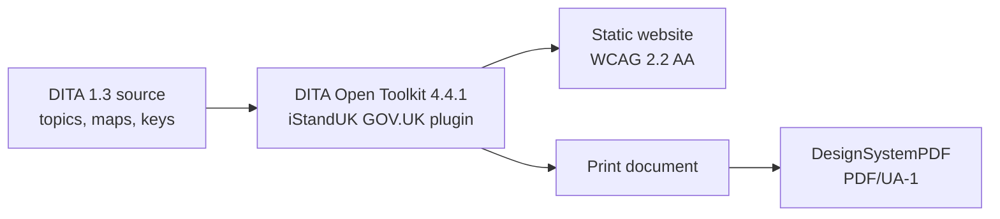

# uFTi-Docs

User documentation for **uFTi** (Understand Your Family Tree Information), a family tree application.

> **Status: planning.** This repository holds the authoring plan and project scaffolding. No documentation topics have been written yet and nothing is published.

## What this will produce

From one set of DITA topics, the build will produce for each supported platform:

- a **static website** using the GOV.UK Design System, built to WCAG 2.2 AA, with semantic HTML and page metadata (Open Graph, Dublin Core, canonical links, sitemap), and
- a **tagged PDF/UA-1 document** of the same manual.

Because not every reader will know family history research good practice, the documentation also includes practical guidance on researching well, linked to the features that support it.

## Scope

In scope for now: the **uFTi .NET MAUI application** on its three supported platforms, **Android**, **iOS** and **Windows**. Android and iOS each cover both phone and tablet, so there are five manuals.

Out of scope for now: the app's AI features, and the other uFTi surfaces (web, command line and AI-assistant integrations). They may be added later.

## How it is built

The tools are the [DITA Open Toolkit](https://www.dita-ot.org/), the [iStandUK GOV.UK DITA plugin](https://github.com/iStandUK/govuk-dita-plugin) (`org.istanduk.gov-uk`) and its companion PDF generator, DesignSystemPDF. Exact versions and checks are in [build and quality](authoring/build-and-quality.md).

## Repository map

| Path | Purpose |
|---|---|
| [`authoring/`](authoring/README.md) | The authoring plan, standards and decision log. Not published. |
| [`content/`](content/README.md) | DITA source: maps, topics, keys and images. Empty until the pilot slice. |
| [`build/`](build/README.md) | Build configuration: filters, project files, theme and scripts. Empty until the toolchain work package. |
| [`LICENSE`](LICENSE), [`NOTICE`](NOTICE) | Apache License 2.0 and notice. |

## Start here

1. [Authoring plan](authoring/authoring-plan.md): scope, audiences, structure, delivery plan and risks.
2. [Decision log](authoring/decision-log.md): what is decided and what needs an answer.
3. [Platform strategy](authoring/platform-strategy.md) and [good practice strategy](authoring/good-practice-strategy.md): the two things that most shape the content.

## Contributing

See [CONTRIBUTING.md](CONTRIBUTING.md). Work happens on the default branch, `dev`. The `main` branch holds releases. While the repository is in its planning phase, please open an issue before sending changes.

## Licence

Licensed under the [Apache License, Version 2.0](LICENSE). See [NOTICE](NOTICE).

The licence does not grant permission to use the uFTi name or logo other than as section 6 of the licence allows.
