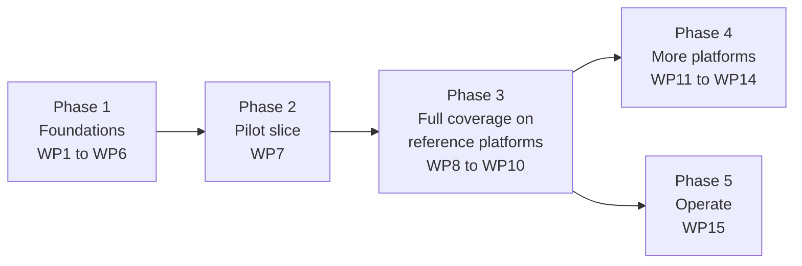

# Authoring plan: uFTi user manual

| | |
|---|---|
| Status | Draft 0.1 |
| Date | 15 October 2026 |
| Scope | The uFTi .NET MAUI application on all its platforms. Web, command-line and AI-assistant integrations are out of scope for now. |
| Companion documents | [Platform strategy](platform-strategy.md) · [Good practice strategy](good-practice-strategy.md) · [Authoring standards](authoring-standards.md) · [Build and quality](build-and-quality.md) · [Decision log](decision-log.md) |

## 1. Purpose and scope

### 1.1 Goal

Give people who use uFTi a manual they can trust: task-based, correct for the platform they are using, accessible, and clear enough for someone who has never done family history research before.

### 1.2 In scope

- The **uFTi MAUI application** on every platform it runs on (see the [platform catalogue](platform-strategy.md#2-platform-catalogue)).
- Every feature a user can reach in a released build, including any AI-assisted features that appear in the app (confirmed by the inventory in WP4).
- Good practice guidance for family history research, linked to the features that support it.

### 1.3 Out of scope for now

| Item | Why, and what happens next |
|---|---|
| uFTi web app and service, command-line tools, AI-assistant integrations | Deferred (DEC-002). The folder layout and attribute vocabulary leave room for each to become its own publication later, through a new `@product` value and new maps. |
| Developer, architecture and API documentation | Different audience and a different repository. |
| Marketing and sales material | Not a user manual concern. |
| Research tutorials by record type (census, parish registers, wills and so on) | We teach method and record keeping. For record types we link to authoritative guides. |
| Translation | Write translation-ready British English first. Decide on Spanish later (Q6). |

### 1.4 Outputs

| Output | For | Formats | Notes |
|---|---|---|---|
| **uFTi user manual: *platform*** (one per platform) | People using uFTi on that platform | Website and PDF/UA-1 | The same topics serve every platform. Platform-specific text and screenshots are selected at build time. |
| **Family history good practice guide** | Anyone, including people new to research | Website and PDF/UA-1 | Platform-neutral. Also included as a part of each platform manual (DEC-007). |
| **Platform chooser** | First-time visitors | Website home page | Links to each manual and to the guide. |

### 1.5 Success criteria

1. Every user-visible feature on each supported platform is covered by at least one task, concept or reference topic, and the inventory proves it.
2. Every task has been performed, on the platform it documents, by someone other than its author.
3. Builds produce no warnings. Automated checks report no WCAG 2.2 AA or HTML errors, and every PDF passes PDF/UA-1 in veraPDF.
4. A first-time family historian can complete the "first family tree" tutorial unaided. We test this with three to five people before v1.0.
5. A reader on any platform can reach the right manual in two steps from the home page, and can search it.
6. Nothing private is published (see [section 7.4](#74-disclosure-boundary-and-privacy)).

## 2. Audiences

| Audience | Who they are | What they need from the manual |
|---|---|---|
| **Newcomer** | Has a few names, perhaps a shoebox of papers or an old tree elsewhere. Does not know what a citation or GEDCOM is. May worry about "doing it wrong". | A first-tree tutorial. Plain-word explanations of concepts. Gentle good practice at the moment it matters. A glossary. |
| **Switcher** | Has a tree in another application and wants to bring it across safely. | Import and export tasks. What is kept and what is not. Checks to run after an import. Where files live on their platform. |
| **Careful researcher** | Cares about evidence, sources and conflicting information. | How uFTi models sources, citations and evidence. Depth and reference material. Standards-based good practice. |
| **Family steward** | Looks after a tree for a wider family, shares it and wants it to last. | Privacy for living people, sharing and export, backups, long-term preservation. |
| **Assistive technology user** (applies to all of the above) | Uses a screen reader, magnification, voice control, switch access or the keyboard alone. | Documented accessibility features for each platform. Documentation that is itself accessible. Keyboard shortcuts. A non-visual description of the tree view. |

**Reading level and tone.** Plain English and short sentences. No unexplained jargon. Kind and non-judgemental about how people research: the manual helps readers do better, it does not scold. Style rules are in [authoring standards, section 11](authoring-standards.md#11-writing-style).

## 3. Information architecture

### 3.1 Principles ("fully topic based")

- **One topic, one purpose, one type.** Concept, task, reference, troubleshooting or glossary entry. Never a blend.
- **Standalone.** A reader who arrives from search understands the topic without reading anything before it. No "above", "below", "previous section" or numbered titles.
- **Task-oriented and minimal.** Start from what the reader wants to do. Explain only what is needed. Help readers recognise and recover from mistakes.
- **Structure lives in maps, not topics.** Order, hierarchy and related links come from maps and relationship tables, so the same topic can sit in several publications.
- **Reuse by reference, not copy.** Keys and content references carry shared facts. Reuse never costs a topic its ability to stand alone.
- **Every topic has** a title, a one-sentence short description, a language and metadata.

### 3.2 Topic types

| Type | DITA element | Use for | Title style | Example (provisional) |
|---|---|---|---|---|
| Concept | `concept` | What something is, why it matters, how it fits | Noun phrase | Workspaces |
| Task | `task` | Steps to reach a goal | Imperative verb | Add a person |
| Reference | `reference` | Facts to look up: lists, tables, shortcuts, field descriptions | Noun phrase | Event types |
| Troubleshooting | `troubleshooting` | A symptom, its cause and its remedy | The symptom, as a reader would say it | A photo does not appear |
| Glossary entry | `glossentry` | A term and its definition | The term | GEDCOM |

### 3.3 Provisional manual outline

Built from the existing screenshot set and the app's visible navigation. WP4 replaces it with an inventory taken from the running app.

| # | Chapter | Purpose | Main topic types | Platform variance |
|---|---|---|---|---|
| 0 | Front matter | About this manual, who it is for, conventions, what is new, accessibility information | concept, reference | Low |
| 1 | Get started | Install, first launch, a tour, the sample workspace, the first-tree tutorial | task, concept | **High** |
| 2 | Workspaces and files | Create, open and switch workspaces. Import and export GEDCOM. Back up. | task, concept, reference | Medium |
| 3 | Find and browse | Search, refine results, the family tree view, moving around | task, concept | Medium |
| 4 | People | View, add, edit and remove a person. Names, sex and gender fields. | task, concept, reference | Medium |
| 5 | Families and relationships | Add a family, link members, relationship types, generations | task, concept | Low |
| 6 | Events, dates and places | Add and edit events and facts. Complex dates. Places. | task, concept, reference | Low |
| 7 | Sources, citations and evidence | Repositories, sources, citations, reconciling evidence | task, concept | Low to medium |
| 8 | Notes and research notes | Notes, research notes and how to use them | task, concept | Low |
| 9 | Photos and media | Link media, take a photo, manage media | task | **High** |
| 10 | Create records with forms | The create menu, forms, census forms | task, concept, reference | Low |
| 11 | Keep your tree healthy | Checks, duplicates, merging (candidate: confirm in WP4) | task, concept | Low |
| 12 | Settings, language and accessibility | Language, appearance, accessibility features, About | task, reference | **High** |
| 13 | Troubleshooting and support | Common problems, diagnostics, reporting a problem | troubleshooting | Medium to high |
| 14 | Reference | Glossary, keyboard shortcuts, event types, date formats, file types, platform differences | reference, glossentry | Medium |
| GP | Good practice guide | Shared by every manual: see [good practice strategy](good-practice-strategy.md) | concept, task, reference | None |

Screens for chapters 2 to 10 appear in the existing screenshot set. Chapters 11 to 13, and the settings part of chapter 12, are candidates to confirm against the app.

### 3.4 Good practice inside the manual

Good practice is not a separate world. It appears in four places: contextual cues inside tasks, a guide part, a learning path for newcomers, and checklists. Relationship tables in the maps link each task to the guidance behind it. Details are in the [good practice strategy](good-practice-strategy.md#4-where-good-practice-appears).

### 3.5 Navigation and discovery

- The home page of each platform manual uses the plugin's `grouped` layout, which is what `auto` selects for a bookmap with several chapters.
- At most three levels of navigation. A chapter holds roughly fifteen topics at most. Beyond that, split it.
- Related links come from relationship tables in the maps (task, concept, good practice), never from hand-written lists in topics.
- A generated glossary and back-of-book index.
- Site search with Pagefind, with filters from each topic's `category` and audience level.
- A "What is new in this manual" topic for every release.

### 3.6 Provisional size

Roughly 100 to 150 manual topics, 40 to 60 good practice topics and 30 to 50 glossary entries, with about three-quarters of the manual shared across platforms. This is a guess to size the work. WP4 replaces it.

## 4. Platforms

Full detail is in the [platform strategy](platform-strategy.md). In summary:

- **One manual per platform, assembled from shared topics.** A reader on Android never wades through Windows instructions.
- **Differences are handled in this order:** neutral wording, then keys (screenshots, UI labels), then small `@platform` variants, then platform-specific topics.
- **Proposed output model:** one build per platform from the shared sources (DEC-006). WP2 proves it against a branch-filtered single-site alternative before we commit.
- **Waves.** Wave 1 (reference platforms): Android phone and Windows (WinUI), the two heads that build on Windows today. Wave 2: Windows (WPF), whose screenshot set already exists, then iOS and macOS, which need a Mac build host. Wave 3: any remaining heads, as the product team confirms them.

## 5. Good practice guidance

Full detail is in the [good practice strategy](good-practice-strategy.md). In summary:

- A dedicated guide, contextual cues in tasks, a learning path for newcomers, checklists and glossary entries.
- **Boundary:** we teach research method and record keeping. We do not write record-type tutorials. We link to authorities for those.
- Content rests on recognised standards (such as the Genealogical Proof Standard), is paraphrased and cited, and is reviewed by an experienced genealogist. Legal and ethical topics get expert review.

## 6. Semantic structure and metadata

"Semantic tagging" works at three layers.

| Layer | What we do | Defined in |
|---|---|---|
| **Source (DITA)** | Semantic elements instead of presentation markup. Controlled metadata in every topic's `prolog`: category, keywords that are real aliases, audience level and dates only where true. `xml:lang` everywhere. Stable file names and identifiers. | [Authoring standards](authoring-standards.md) |
| **Website (HTML)** | The plugin supplies HTML5 landmarks, one `h1` per page, a skip link and WCAG 2.2 AA components. Page `head` metadata is read from the DITA: title, description, language, Open Graph, Dublin Core, and canonical, previous, next and licence links. With a site URL set it also writes `sitemap.xml`, `robots.txt` and `llms.txt`. | [Build and quality](build-and-quality.md#3-build-parameters) |
| **PDF** | DesignSystemPDF writes tagged PDF/UA-1: structure tags, document title and language, bookmarks from headings, alternative text on figures, table headers, embedded fonts, and page-numbered contents and index. | [Build and quality](build-and-quality.md#4-quality-gates) |

The plugin also plans richer typed metadata (for example how-to and defined-term markup, and catalogue vocabularies). We write the source metadata now. It is valid DITA, and it is ignored harmlessly until the plugin supports it, so nothing will need rewriting.

## 7. Authoring workflow and quality

### 7.1 Roles

| Role | Responsibility |
|---|---|
| Author | Drafts topics from the inventory and observed behaviour. |
| Technical reviewer | Confirms accuracy against the app on the platform. |
| Genealogy reviewer | Reviews topics that give research advice. |
| Accessibility and plain-language reviewer | Checks reading level, structure, alternative text and link text. |
| Publisher | Owns the build, the release and the toolchain versions. |

One person may hold several roles, but nobody reviews their own work in the same role. Automated gates support human review. They do not replace it.

### 7.2 Lifecycle of a topic

1. **Plan.** A row in the inventory and an issue.
2. **Draft.** From a template, using observed behaviour on a real build.
3. **Self-check.** Build locally. Fix warnings, lint and spelling.
4. **Technical review.** Someone performs every step on each platform the topic covers.
5. **Genealogy review.** Only for topics that give research advice.
6. **Accessibility and plain-language review.**
7. **Merge.** A pull request with all automated gates green.
8. **Publish.** With the next release of the manual.
9. **Maintain.** Revisit when the app changes, and on the review cycle for good practice content.

### 7.3 Definition of done

A topic is done when:

- [ ] It is valid DITA 1.3 and builds with no warnings in every platform build that includes it.
- [ ] File name, `id`, title and short description follow the standards. `xml:lang="en-GB"`. Metadata is complete.
- [ ] It stands alone: it makes sense when reached from search, with no positional references.
- [ ] Every image has alternative text (for screenshots, the key's link text) and a caption where one helps.
- [ ] Platform differences are handled at the right level, with no more than three inline variants.
- [ ] Links use keys. Related links come from the relationship table. Link text makes sense out of context.
- [ ] Every step has been performed on each platform it applies to, on a released or release-candidate build, by someone other than the author.
- [ ] Technical review is done, and genealogy review where it applies.
- [ ] Accessibility and plain-language review is done. Lint, spelling and automated gates pass.
- [ ] It uses sample data only and contains nothing private.

### 7.4 Disclosure boundary and privacy

This repository is public. The application repository is private.

| Allowed | Not allowed |
|---|---|
| Behaviour a user can observe in a released build | Source code or snippets, project or class names |
| UI labels as they appear on screen | Internal design documents or architecture decision records |
| Screenshots of sample workspaces | Issue or pull request numbers, build or CI identifiers, local paths |
| Published standards and public guidance | Unreleased features, security details |
| | Real family data, or any information about living people |

- Screenshots and examples show fictional characters or people who died long ago. They never show living people, public figures included. WP5 checks the existing sample workspaces and screenshots against this rule.
- Anything imported from the application repository (WP5) is sanitised first.
- The pull request checklist includes a scan for the "not allowed" patterns, plus a secret scan in CI.
- `*.ged`, `*.gdz` and `*.gedzip` files are git-ignored as a safety net.

### 7.5 AI-assisted drafting

AI assistance may be used to draft topics, check terminology and consistency, suggest alternative text and triage lint output. The rules:

1. AI works from the approved inventory and observed behaviour. It does not invent features, screens or labels.
2. Every AI-drafted task is performed on the platform before merge.
3. AI does not produce screenshots or mock-ups of the app.
4. Good practice content traces to cited authorities and is reviewed by a human genealogist. Summaries of copyrighted works are paraphrased, never reproduced.
5. Pull request descriptions say which topics were AI-assisted.
6. Whether the colophon states this publicly is an open decision (Q10).

### 7.6 Keeping the manual in step with the app

- App issues and pull requests that change what a user sees carry a *docs impact* label. The repositories are separate, so this is a manual process.
- On each release candidate: compare the app against the inventory, refresh affected screenshots, and update the "What is new" topic.
- Screenshot refresh triggers: a label or layout change, a new or removed feature, and a major operating system update.
- The manual describes the latest release. Earlier versions are kept as tagged releases (DEC-013).

## 8. Delivery plan

Sizes are relative (S, M, L, XL), not calendar estimates. WP7 measures the real effort per topic. After that, WP8 to WP14 are re-estimated.

| ID | Work package | Size | Depends on | Deliverables | Done when |
|---|---|---|---|---|---|
| **Phase 1: Foundations** | | | | | |
| WP1 | Toolchain and build pipeline | L | none | `build/tools.lock` pinning every tool by version and SHA-256. Bootstrap and build scripts for Windows (PowerShell) and CI (bash). A DITA-OT project file. A GitHub Actions workflow with the quality gates. A tiny throwaway fixture publication. | The fixture builds locally and in CI to a website and a PDF with zero warnings, and every gate in [build and quality, section 4](build-and-quality.md#4-quality-gates) runs green on it. |
| WP2 | Platform strategy spike | M | WP1 | A prototype of three platforms by four topic kinds (shared, shared with a variant, platform-specific, image by key). A decision between the build models. The good practice callout pattern. The platform chooser approach. | Decision accepted in the log. The prototype builds for all three platforms. veraPDF passes PDF/UA-1 and there is no `DSPDF009W`. Alternative text from keys reaches HTML and PDF. |
| WP3 | Standards, style guide and templates | M | none (parallel to WP1) | Full style guide. Terminology list. Templates for each topic type. Metadata vocabulary. Lint configuration. Contributor guide. | Adopted by the maintainers. Lint runs in CI against the templates. |
| WP4 | Content inventory and information architecture | M | Access to the app. WP3 started. | Features observed on released builds on each reference platform. A topic inventory (id, title, type, chapter, platforms, priority, status, reviewer). Chapter map skeletons. | Every visible screen and feature maps to at least one planned topic. Reviewed with the product owner. |
| WP5 | Import and sanitise the existing screenshot maps | S | WP2 | The three existing platform key maps and their screenshots, brought in and sanitised. | No internal identifiers, personal data or living people appear. Alternative text reviewed. A key coverage report exists. |
| WP6 | Brand and site furniture | S | WP1 | Publisher stylesheet, logo, favicon, share image, footer links, phase banner and feedback link. | A neutral-branded build shows the uFTi identity. Contrast and target size pass axe-core. |
| **Phase 2: Pilot** | | | | | |
| WP7 | Pilot slice | L | WP1 to WP6 | Get started, People and Sources chapters, five good practice topics and a glossary starter, for the two reference platforms (about 30 to 40 topics). | Published as a beta. The full review workflow has been exercised. Three to five novice usability sessions are done. Effort per topic is recorded. |
| **Phase 3: Full coverage on reference platforms** | | | | | |
| WP8 | Core manual chapters | XL | WP7 | All remaining chapters, reference topics, troubleshooting and glossary. | Inventory coverage is 100% for in-scope features on the reference platforms. |
| WP9 | Good practice guide v1 | L | WP7, reviewer availability | All themes, contextual cues, learning path and checklists. | Genealogy review passed. Novice usability test passed. Every cue links to the guide. |
| WP10 | Release readiness for v1.0 | M | WP8, WP9 | Accessibility statement. Colophon with licences and third-party notices. "What is new". Manual assistive technology pass. PDF reading-order check. Deployment. | All gates green. Manual checks logged. Site and PDFs published. |
| **Phase 4: More platforms** | | | | | |
| WP11 to WP14 | Add a platform: Windows (WPF), iOS, macOS, others as confirmed | S to M each | WP10 | Follow the [onboarding checklist](platform-strategy.md#9-adding-a-platform). | Coverage report shows parity with the reference platforms. Gates green. |
| **Phase 5: Operate** | | | | | |
| WP15 | Operate and maintain | Ongoing | WP10 | Docs-impact process. Screenshot refresh. Periodic good practice review. Tool upgrade policy. | The cadence has been followed for two app releases. |
| WP16 | Localisation (Spanish) | Optional | WP10, Q6 | Translation workflow and first translated publication. | Decided in Q6. |
| WP17 | Other uFTi surfaces | Deferred | DEC-002 | Scoping only. | Not planned. |

**Milestones.** M1 toolchain proven (WP1, WP2). M2 standards in place (WP3, WP4). M3 pilot published as a beta (WP5 to WP7). M4 v1.0 on the reference platforms (WP8 to WP10). M5 further platforms (WP11 to WP14).

**Parallelism.** WP1, WP3 and WP4 can start together. WP2 follows WP1. WP5 and WP6 follow WP2.

## 9. Risks

| ID | Risk | Likelihood | Impact | Mitigation |
|---|---|---|---|---|
| R1 | The plugin (v1.x) and the PDF generator (0.x) are young and moving fast. | High | Medium | Pin by version and checksum. Upgrade deliberately. Run the gates on every upgrade. Report issues upstream. |
| R2 | DITA-OT 4.4 behaviours: keys inside a submap included by key are not resolved. Chunking has defects. | Certain | Medium | Include submaps by `href` only. Avoid `chunk="to-content"`. The standards forbid both. |
| R3 | Pre-release app UI changes, so documentation goes stale. | High | High | Screenshots as keys with stable names. Capture from release candidates. Docs-impact process. Document only stable features. Beta phase banner. |
| R4 | Platform multiplication: N platforms by M topics. | Medium | High | Single-source. Variant thresholds. Coverage report. Add platforms in waves. |
| R5 | Some platform heads change or are withdrawn. | Medium | Low | Keep each platform in its own folders so removal is cheap. Document only confirmed heads. |
| R6 | Good practice advice is wrong, outdated or legally unsafe. | Medium | High | Cite authorities. Genealogy and expert review. Review cycle. No legal advice. |
| R7 | Copyright of third-party standards, images or text. | Low | High | Paraphrase and cite. Only our own screenshots. Bundled fonts under open licences. |
| R8 | Accidental disclosure from the private repository into the public one. | Medium | High | The [disclosure boundary](#74-disclosure-boundary-and-privacy), sanitised imports, secret scan, reviewer checklist. |
| R9 | Accessibility regressions. | Medium | High | Automated gates on every build. Manual assistive technology tests every release. |
| R10 | One maintainer. | High | Medium | Docs as code. Scripted builds. Written standards. Small, well-described pull requests. |
| R11 | Windows toolchain quirks: toolkit under a path with spaces, Unix script under Git Bash, long paths. | High | Low | A short, writable toolkit folder, `dita.bat`, documented in [build and quality](build-and-quality.md#2-local-environment). |
| R12 | Screenshot capture effort across platforms. | High | Medium | Scripted capture. Stable names. Sample workspaces. Reference devices recorded in the key maps. |

## 10. Decisions and open questions

Everything decided, proposed or open is in the [decision log](decision-log.md). The questions that most affect the start of work:

| Q | Question | Default if unanswered |
|---|---|---|
| Q1 | Which platforms are supported in v1? | Android phone and Windows (WinUI) first, then the rest as confirmed. |
| Q2 | Are phone and tablet separate manuals? | No. One manual per operating system and head. |
| Q3 | Are AI-assisted features visible in the app in scope? | Yes, as far as they are visible at release. |
| Q4 | Where is the site hosted? | GitHub Pages, with a platform chooser at the root. |
| Q5 | Which brand assets (logo, colours) are available? | A plain masthead with the service name until supplied. |
| Q6 | Is Spanish needed, and when? | Not for v1. |

## 11. References

- [DITA 1.3 specification](https://docs.oasis-open.org/dita/dita/v1.3/) (OASIS) and the [DITA Open Toolkit](https://www.dita-ot.org/).
- [iStandUK GOV.UK DITA plugin](https://github.com/iStandUK/govuk-dita-plugin), including its manual and its guide for systems that generate DITA.
- [GOV.UK Design System](https://design-system.service.gov.uk/) and [GOV.UK style guide](https://www.gov.uk/guidance/style-guide).
- [WCAG 2.2](https://www.w3.org/TR/WCAG22/) and ISO 14289-1 (PDF/UA-1), checked with [veraPDF](https://verapdf.org/).
- [Pagefind](https://pagefind.app/) and [axe-core](https://github.com/dequelabs/axe-core).
- Board for Certification of Genealogists, [ethics and standards](https://bcgcertification.org/ethics-standards), including the Genealogical Proof Standard and the *Genealogy Standards* manual (second edition).
- [GEDCOM](https://gedcom.io/), the family tree data standard.
