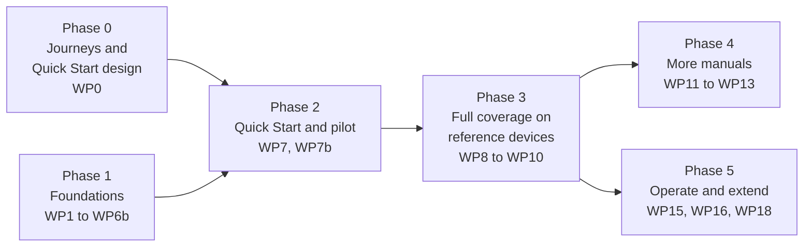

# Authoring plan: uFTi user manual

| | |
|---|---|
| Status | Draft 0.4 |
| Date | 16 October 2026 |
| Scope | The uFTi .NET MAUI application on Android (phone and tablet), iOS (iPhone and iPad) and Windows. Web, command-line and AI-assistant integrations, and the app's AI features, are out of scope for now. |
| Companion documents | [Content model](content-model.md) · [Platform strategy](platform-strategy.md) · [Screenshot strategy](screenshot-strategy.md) · [Dataset strategy](dataset-strategy.md) · [Good practice strategy](good-practice-strategy.md) · [Site strategy](site-strategy.md) · [Authoring standards](authoring-standards.md) · [Build and quality](build-and-quality.md) · [Decision log](decision-log.md) · [Review of Draft 0.3](review-draft-0.3.md) |

## 1. Purpose and scope

### 1.1 Goal

Make using uFTi as easy as possible, without putting off anyone who does not want to read the manual.

So the documentation is designed first for the person who never opens it: the words on screen, a help button that opens the right page, and a ten-minute Quick Start. The full manual is there for those who want it: task-based, correct for the device they are using, accessible, and clear enough for an average 11-year-old, including someone who has never done family history research before.

### 1.2 In scope

- The **uFTi MAUI application** on its three supported platforms: Android, iOS and Windows (WinUI). Android and iOS each cover both the phone and the tablet idiom (see the [platform catalogue](platform-strategy.md#2-platform-catalogue)).
- Every feature a user can reach in a released build, except AI features (confirmed by the inventory in WP4).
- A **Quick Start** per device, an **in-app help map**, and the **content tiers** that put the shortest route first ([content model](content-model.md)).
- Good practice guidance for family history research, linked to the features that support it, and published as a resource in its own right.
- The pages of **ufti.com** and the store listings, which share the manuals' screenshots, theme and reading level ([site strategy](site-strategy.md)).

### 1.3 Out of scope for now

| Item | Why, and what happens next |
|---|---|
| uFTi web app and service, command-line tools, AI-assistant integrations | Deferred (DEC-002). The folder layout and attribute vocabulary leave room for each to become its own publication later, through a new `@product` value and new maps. |
| AI features of the app, and guidance on using AI tools | Deferred (DEC-020). The inventory excludes them. Where one appears on a documented screen, the topic describes the screen without it. |
| Other MAUI platform heads | Only Android, iOS and Windows (WinUI) are supported platforms (DEC-019). Other heads are not documented. |
| Developer, architecture and API documentation | Different audience and a different repository. |
| Research tutorials by record type (census, parish registers, wills and so on) | We teach method and record keeping. For record types we link to authoritative guides. |
| DNA, beyond one topic on its risks and issues | Decided (DEC-037). No how-to, and no recording of DNA. |
| GEDCOM tags, structures and file contents | Never shown (DEC-030). They are not human-centred. The standard is the source of meaning for the field reference, in plain words. |
| Video embedded in the manual | Never (DEC-034). Any video is hosted elsewhere and linked, and the manual stands without it. |
| The full manual in Spanish at v1 | The Quick Start and installation ship in Spanish at v1, the rest later (DEC-038). |

### 1.4 Outputs

| Output | For | Formats | Notes |
|---|---|---|---|
| **Quick Start** (one per device) | Everyone, first | Website, and a two-page PDF of its own | Seven pages, ten minutes ([content model, section 3](content-model.md#3-the-quick-start)). Its own bookmap. |
| **uFTi user manual: *device*** (Android phone, Android tablet, iPhone, iPad and Windows) | People using uFTi on that device | Website and PDF/UA-1 | The same topics serve every manual. Idiom-specific text and screenshots are selected at build time. |
| **Family history good practice guide** | Anyone, including people new to research | Website and PDF/UA-1 | Platform-neutral. Included as a part of each manual (DEC-007), and published at ufti.com as a public resource. |
| **Help map** | The app | A generated file per device and language | Screen identifier to page URL ([content model, section 5](content-model.md#5-in-app-help)). |
| **Device chooser** | First-time visitors | Website | "What are you using uFTi on?" |
| **ufti.com pages** | Visitors | Website | Marketing, support, privacy, accessibility statement, legal ([site strategy](site-strategy.md)). |

### 1.5 Success criteria

1. Every user-visible feature on each supported platform is covered by at least one task, concept or reference topic, and the inventory proves it.
2. Every task has been performed, on the platform it documents, by someone other than its author.
3. Builds produce no warnings. Automated checks report no WCAG 2.2 AA or HTML errors, and every PDF passes PDF/UA-1 in veraPDF.
4. A first-time family historian can complete the "first family tree" tutorial unaided. We test this with three to five people before v1.0.
5. A reader on any device can reach the right manual in two steps from the home page, and can search it.
6. Nothing private is published (see [section 7.4](#74-disclosure-boundary-and-privacy)).
7. The Quick Start, the tutorial, the task examples, the screenshots and the guide's worked examples all use one dataset, and every claim in it has its evidence in the register ([dataset strategy](dataset-strategy.md)).
8. **Four out of five novices complete the Quick Start unaided in ten minutes or less.**
9. **Every screen in the inventory has an in-app help target.**
10. **Every topic meets the reading-level targets** ([standards, section 11](authoring-standards.md#11-writing-style)).

### 1.6 Constraints from the product plan

- **The client is free, and revenue may come later** from AI models or a record-sync service across clients and platforms. The documentation must not block either: topics never state pricing, "free", "forever", accounts or where data lives; sync and AI are absent until shipped; the chapter structure leaves room (DEC-040, [site strategy, section 6](site-strategy.md#6-business-model-independence)).
- **The project may go open source.** Nothing in the plan depends on the application repository staying private. If it opens, the disclosure boundary and the contributor path are reviewed (DEC-041).

## 2. Audiences

| Audience | Who they are | What they need |
|---|---|---|
| **Non-reader** (most people) | Opens the app, not the manual. Will use a help button if it answers the question in front of them. | Good words on screen. A help button that opens the right page. A Quick Start they can finish in ten minutes if they ever look. |
| **Newcomer** | Has a few names, perhaps a shoebox of papers or an old tree elsewhere. Does not know what a citation or a family tree file is. May worry about "doing it wrong". | The Quick Start, then a first-tree tutorial. Plain-word explanations of concepts. Gentle good practice at the moment it matters. A glossary. |
| **Young person** | Doing a school project or helping a grandparent. Reads at or around the target level. | The Quick Start. Clear guidance on living relatives and what to share. Plain treatment of hard subjects. |
| **Switcher** | Has a tree in another application and wants to bring it across safely. | Import and export tasks. What is kept and what is not. Checks to run after an import. Where files live on their platform. |
| **Careful researcher** | Cares about evidence, sources and conflicting information. | How uFTi models sources, citations, evidence and research threads. Depth and reference material. Standards-based good practice. |
| **Family steward** | Looks after a tree for a wider family, shares it and wants it to last. | Privacy for living people, sharing and export, backups, long-term preservation. |
| **Assistive technology user** (applies to all of the above) | Uses a screen reader, magnification, voice control, switch access or the keyboard alone. | Documented accessibility features for each platform. Documentation that is itself accessible. Keyboard shortcuts. A non-visual description of the tree view. |

**Reading level and tone.** Written for an average 11-year-old, with measurable targets enforced in the build (DEC-029). No unexplained jargon. Kind and non-judgemental about how people research: the manual helps readers do better, it does not scold. Style rules are in [authoring standards, section 11](authoring-standards.md#11-writing-style).

## 3. Information architecture

### 3.1 Content tiers

The shortest route comes first (DEC-026): the words on screen, then a Quick Start, then how-to tasks, then concepts and the guide, then reference. A reader must be able to succeed at the Quick Start without the rest. The tiers, the Quick Start, the user journeys that shape them, the in-app help and the learning modalities are in the [content model](content-model.md).

### 3.2 Principles ("fully topic based")

- **One topic, one purpose, one type.** Concept, task, reference, troubleshooting or glossary entry. Never a blend.
- **Standalone.** A reader who arrives from search or the help button understands the topic without reading anything before it. No "above", "below", "previous section" or numbered titles.
- **Task-oriented and minimal.** Start from what the reader wants to do. Explain only what is needed. Help readers recognise and recover from mistakes.
- **Structure lives in maps, not topics.** Order, hierarchy and related links come from maps and relationship tables, so the same topic can sit in several publications.
- **Reuse by reference, not copy.** Keys and content references carry shared facts. Reuse never costs a topic its ability to stand alone.
- **Every topic has** a title, a one-sentence short description, a language, metadata and, for a screen, a help identifier.

### 3.3 Topic types

| Type | DITA element | Use for | Title style | Example (provisional) |
|---|---|---|---|---|
| Concept | `concept` | What something is, why it matters, how it fits | Noun phrase | Workspaces |
| Task | `task` | Steps to reach a goal | Imperative verb | Add a person |
| Reference | `reference` | Facts to look up: lists, tables, shortcuts, field descriptions | Noun phrase | Event types |
| Troubleshooting | `troubleshooting` | A symptom, its cause and its remedy | The symptom, as a reader would say it | A photo does not appear |
| Glossary entry | `glossentry` | A term and its definition | The term | Family tree file |

### 3.4 Provisional manual outline

Built from the existing screenshot set and the app's visible navigation. WP0's journeys set the order, and WP4 replaces it with an inventory taken from the running app.

| # | Chapter | Purpose | Main topic types | Idiom variance |
|---|---|---|---|---|
| S | Start here | The Quick Start: get it, look around, explore the Brontë family, add a person, say where you found it, keep it safe, what next | task, concept | **High** (platform at the edges) |
| 0 | Front matter | About this manual, who it is for, conventions, what is new, accessibility information | concept, reference | Low |
| 1 | Get started | Install, first launch, a tour, and the first-tree tutorial that builds the Brontë workspace | task, concept | **High** |
| 2 | Workspaces and files | Create, open and switch workspaces. Import and export a family tree file. Back up. | task, concept, reference | Medium |
| 3 | Find and browse | Search, refine results, the family tree view, moving around | task, concept | Medium |
| 4 | People | View, add, edit and remove a person. Names, sex and gender fields. | task, concept, reference | Medium |
| 5 | Families and relationships | Add a family, link members, relationship types, generations | task, concept | Low |
| 6 | Events, dates and places | Add and edit events and facts. Complex dates. Places. | task, concept, reference | Low |
| 7 | Sources, citations and evidence | Repositories, sources, citations, weighing evidence, research threads | task, concept | Low to medium |
| 8 | Notes and research notes | Notes, research notes and how to use them | task, concept | Low |
| 9 | Photos and media | Link media, take a photo, manage media | task | **High** |
| 10 | Create records with forms | The create menu, forms, census forms | task, concept, reference | Low |
| 11 | Keep your tree healthy | Checks, duplicates, merging (candidate: confirm in WP4) | task, concept | Low |
| 12 | Settings, language and accessibility | Language, appearance, accessibility features, About | task, reference | **High** |
| 13 | Troubleshooting and support | Common problems, diagnostics, reporting a problem | troubleshooting | Medium to high |
| 14 | Reference | Glossary, keyboard shortcuts, event types, date formats, file types, device differences, the field reference | reference, glossentry | Medium |
| GP | Good practice guide | Shared by every manual, and public on its own: see [good practice strategy](good-practice-strategy.md) | concept, task, reference | None |
| (R) | Reserved | "Keep your tree in step across devices" and "Assistants": names held for sync and AI, not written until they ship (DEC-040) | | |

Screens for chapters 2 to 10 appear in the existing screenshot set. Chapters 11 to 13, and the settings part of chapter 12, are candidates to confirm against the app. Screens that mention AI features are documented without them.

### 3.5 Good practice inside the manual

Good practice is not a separate world, and it is never required reading. It appears in four places: one-line cues inside tasks, a guide part, a learning path for newcomers, and checklists. Relationship tables in the maps link each task to the guidance behind it. Details are in the [good practice strategy](good-practice-strategy.md#4-where-good-practice-appears).

### 3.6 Navigation and discovery

- The Quick Start is the first entry on every manual's home page, and a task finder ("I want to") is the second.
- The home page uses the plugin's `grouped` layout, which is what `auto` selects for a bookmap with several chapters.
- At most three levels of navigation. A chapter holds roughly fifteen topics at most. Beyond that, split it.
- Related links come from relationship tables in the maps (task, concept, good practice), never from hand-written lists in topics.
- A generated glossary and back-of-book index.
- Site search with Pagefind, with filters from each topic's `category` and audience level, and the words readers use in keywords.
- The help button in the app opens the page for the screen ([content model, section 5](content-model.md#5-in-app-help)).
- A "What is new in this manual" topic for every release.

### 3.7 Provisional size

Roughly 100 to 150 manual topics, 40 to 60 good practice topics and 30 to 50 glossary entries, with about three-quarters of the manual shared across devices, plus seven Quick Start pages per device. This is a guess to size the work. WP4 replaces it.

**The minimum for the first app release** (DEC-044): the Quick Start for each wave-1 device, installation, the first-tree tutorial, the top ten tasks from the journeys, the help map for the screens they cover, and a glossary. The rest follows.

### 3.8 A running example

The manual teaches with one worked example: a small illustrative dataset about the family of the Reverend Patrick Brontë of Haworth and his literary children (DEC-025), shown as research in progress (DEC-031). It lets us show the whole user journey with one story, from creating a workspace, through adding and enriching people and families, to notes, events, sources, repositories and a research thread followed to a conclusion.

- **Built by using the process.** The dataset is not prepared and loaded. Authors build it by performing the manual's own tasks, in order, in the app. A topic's steps are the steps they took, and the capture scripts replay the same journey to make the screenshots. A reference workspace built through the MCP checks the result (DEC-039).
- **One story everywhere.** The same people appear in the Quick Start, the tutorial, the task examples, the screenshots and the good practice guide.
- **Honest by rule.** Every claim has its evidence in the register. Contradictions are recorded as competing evidence with the thread that weighs them, never excluded. Nothing is invented. It is a research workspace in progress, not a complete genealogy of the family.
- **Safe by construction.** Everyone in it died long ago, and none of Patrick's children is known to have left children, so no living person appears. WP4b confirms this from sources.

The scope, the nine journey stages, the evidence rules and how it is built are in the [dataset strategy](dataset-strategy.md).

### 3.9 Learning modalities, diagrams and video

Every key concept is offered four ways, see, read, do and check, so a reader can choose a route rather than be sorted into a "learning style" (DEC-035). Diagrams are clickable SVG, inlined so their links work (DEC-036). Video is never embedded (DEC-034). Details are in the [content model, sections 6 and 7](content-model.md#6-learning-modalities).

### 3.10 In-app help

Each topic that documents a screen carries that screen's identifier, and the build generates a help map per device and language that the app uses to open the right page (DEC-028). The app's side is Q22. Details are in the [content model, section 5](content-model.md#5-in-app-help).

## 4. Platforms

Full detail is in the [platform strategy](platform-strategy.md). In summary:

- **Three supported platforms:** Android, iOS and Windows (WinUI). Android and iOS each cater for the phone and the tablet idiom (DEC-019).
- **Idiom first, platform at the edges** (DEC-032). Topics are written for an idiom: phone, tablet or desktop. Platform tokens are used only where the operating system matters: installing, updating, permissions, files, accessibility features and backup.
- **One manual per device, assembled from shared topics:** Android phone, Android tablet, iPhone, iPad and Windows. A reader on an iPad never wades through iPhone or Windows instructions.
- **Differences are handled in this order:** neutral wording, then keys (screenshots, UI labels), then small `@platform` variants, then idiom- or platform-specific topics.
- **Proposed output model:** one build per manual from the shared sources (DEC-006). WP2 proves it against a branch-filtered single-site alternative before we commit. Q16 asks whether phone and tablet should instead share one manual per operating system.
- **Waves.** Wave 1, the reference devices: Android phone and Windows, which already have screenshot sets. Wave 2: Android tablet, then iPhone and iPad, which need a Mac build host (DEC-021).

## 5. Good practice guidance

Full detail is in the [good practice strategy](good-practice-strategy.md). In summary:

- A dedicated guide, one-line cues in tasks, a learning path for newcomers, checklists and glossary entries. Never required reading.
- **Boundary:** we teach research method and record keeping, including how to manage research threads and evidence that disagrees. We do not write record-type tutorials. We link to authorities for those.
- **DNA:** one topic on the risks and issues, and nothing more (DEC-037).
- Content rests on recognised standards (such as the Genealogical Proof Standard), is paraphrased and cited, and is reviewed by an experienced genealogist. Legal and ethical topics get expert review.
- **Worked examples** come from the same dataset as the tutorial, so a reader meets the same people in the guide ([dataset strategy](dataset-strategy.md)).
- The guide is published at ufti.com as a resource in its own right, because it draws people to a free client ([site strategy](site-strategy.md)).

## 6. Semantic structure and metadata

"Semantic tagging" works at three layers.

| Layer | What we do | Defined in |
|---|---|---|
| **Source (DITA)** | Semantic elements instead of presentation markup. Controlled metadata in every topic's `prolog`: category, keywords that are real aliases, audience level, a help identifier for screens, and dates only where true. `xml:lang` everywhere. Stable file names and identifiers. | [Authoring standards](authoring-standards.md) |
| **Website (HTML)** | The plugin supplies HTML5 landmarks, one `h1` per page, a skip link and WCAG 2.2 AA components. Page `head` metadata is read from the DITA: title, description, language, Open Graph, Dublin Core, and canonical, previous, next and licence links. With a site URL set it also writes `sitemap.xml`, `robots.txt` and `llms.txt`. | [Build and quality](build-and-quality.md#3-build-parameters) |
| **PDF** | DesignSystemPDF writes tagged PDF/UA-1: structure tags, document title and language, bookmarks from headings, alternative text on figures, table headers, embedded fonts, and page-numbered contents and index. | [Build and quality](build-and-quality.md#4-quality-gates) |

The plugin also plans richer typed metadata (for example how-to and defined-term markup, and catalogue vocabularies). We write the source metadata now. It is valid DITA, and it is ignored harmlessly until the plugin supports it, so nothing will need rewriting.

**Human-centred, not file-centred.** The manual never shows a GEDCOM tag, record name or line of a file. The GEDCOM 7 structure definitions are the source of meaning for the field reference and the glossary, rendered in plain words and keyed by the label on screen (DEC-030).

## 7. Authoring workflow and quality

### 7.1 Roles

| Role | Responsibility |
|---|---|
| Author | Drafts topics from the inventory and observed behaviour, by doing the tasks. |
| Technical reviewer | Confirms accuracy against the app on the device. |
| Genealogy reviewer | Reviews topics that give research advice, and the evidence register. |
| Accessibility and plain-language reviewer | Checks reading level, structure, alternative text, link text and diagrams. |
| Usability facilitator | Runs journey and Quick Start sessions with novices, and records the results. |
| Spanish reviewer | Reviews the Spanish edition and the choice of its family. |
| Publisher | Owns the build, the release, the site and the toolchain versions. |

One person may hold several roles, but nobody reviews their own work in the same role. Automated gates support human review. They do not replace it.

### 7.2 Lifecycle of a topic

1. **Plan.** A row in the inventory and an issue, placed on a journey.
2. **Draft.** From a template, by doing the task on a real build with the Brontë dataset.
3. **Self-check.** Build locally. Fix warnings, lint, spelling and reading level.
4. **Technical review.** Someone performs every step on each device the topic covers.
5. **Genealogy review.** Only for topics that give research advice.
6. **Accessibility and plain-language review.**
7. **Merge.** A pull request with all automated gates green.
8. **Publish.** With the next release of the manual.
9. **Maintain.** Revisit when the app changes, and on the review cycle for good practice content.

### 7.3 Definition of done

A topic is done when:

- [ ] It is valid DITA 1.3 and builds with no warnings in every manual that includes it.
- [ ] File name, `id`, title and short description follow the standards. `xml:lang="en-GB"`. Metadata is complete, including the help identifier for a screen.
- [ ] It stands alone: it makes sense when reached from search or the help button, with no positional references.
- [ ] It meets the reading-level targets, or every exception is a term with a glossary entry.
- [ ] Every image has alternative text (for screenshots, the key's link text) and a caption where one helps. Every diagram has a title, a description and a text route to what it links.
- [ ] Idiom and platform differences are handled at the right level, with no more than three inline variants.
- [ ] Links use keys. Related links come from the relationship table. Link text makes sense out of context.
- [ ] Every step has been performed on each device it applies to, on a released or release-candidate build, by someone other than the author.
- [ ] Technical review is done, and genealogy review where it applies.
- [ ] Accessibility and plain-language review is done. Lint, spelling and automated gates pass.
- [ ] Its examples come from the Brontë dataset, and it contains nothing private.
- [ ] It shows no GEDCOM tag or structure, and makes no statement about price, accounts or where data lives (DEC-030, DEC-040).

### 7.4 Disclosure boundary and privacy

This repository is public. The application repository is private.

| Allowed | Not allowed |
|---|---|
| Behaviour a user can observe in a released build | Source code or snippets, project or class names |
| UI labels as they appear on screen | Internal design documents or architecture decision records |
| Screenshots of the Brontë dataset, and of other named sample workspaces | Issue or pull request numbers, build or CI identifiers, local paths |
| Published standards and public guidance | Unreleased features, security details |
| | Real family data, or any information about living people |

- Screenshots and examples show people who died long ago, or plainly fictional ones. They never show living people, public figures included. The Brontë dataset is the default ([dataset strategy](dataset-strategy.md#9-privacy-and-care)). WP4b confirms it contains no living person, and WP4 checks any other sample workspace against this rule.
- Anything imported from the application repository (WP5) is sanitised first.
- The pull request checklist includes a scan for the "not allowed" patterns, plus a secret scan in CI.
- `*.ged`, `*.gdz` and `*.gedzip` files are git-ignored as a safety net.
- If the application goes open source, this boundary is reviewed (DEC-041).

### 7.5 AI-assisted drafting

This section is about how we write the documentation. It does not bring the app's AI features into scope (DEC-020). AI assistance may be used to draft topics, check terminology, consistency and reading level, suggest alternative text and triage lint output. The rules:

1. AI works from the approved inventory and observed behaviour. It does not invent features, screens or labels.
2. Every AI-drafted task is performed on the device before merge.
3. AI does not produce screenshots or mock-ups of the app.
4. Good practice content traces to cited authorities and is reviewed by a human genealogist. Summaries of copyrighted works are paraphrased, never reproduced.
5. Pull request descriptions say which topics were AI-assisted.
6. Whether the colophon states this publicly is an open decision (Q10).

### 7.6 Keeping the manual in step with the app

- App issues and pull requests that change what a user sees carry a *docs impact* label. The repositories are separate, so this is a manual process.
- On each release candidate: compare the app against the inventory, refresh affected screenshots, regenerate the help map, and update the "What is new" topic.
- Screenshots are captured on release candidates only (DEC-023). What to look for: a label or layout change, a new or removed feature, and a major operating system update. If release candidates are rare, the beta phase banner says so and the manual's date is shown.
- The manual describes the latest release. Earlier versions are kept as tagged releases (DEC-013).

## 8. Delivery plan

Sizes are relative (S, M, L, XL), not calendar estimates. WP7 measures the real effort per topic. After that, WP8 to WP13 are re-estimated. Each work package has a GitHub issue; the Issue column links it.

| ID | Work package | Size | Depends on | Deliverables | Done when | Issue |
|---|---|---|---|---|---|---|
| **Phase 0: Journeys** | | | | | | |
| WP0 | User journeys and Quick Start design | M | Access to the app | Five to seven one-page journeys ([content model, section 4](content-model.md#4-user-journeys)). The Quick Start outline per device and the "Five things to know" outline. The task-finder list. The list of screens that need a help target. Sessions with three to five novices. | Journeys tested and revised. The Quick Start outline, chapter order and task finder are accepted. Findings about the app's own first-run experience are passed to the app team. | [#6](https://github.com/oughnic/uFTi-Docs/issues/6) |
| **Phase 1: Foundations** | | | | | | |
| WP1 | Toolchain and build pipeline | L | none | `build/tools.lock` pinning every tool by version and SHA-256. Bootstrap and build scripts for Windows (PowerShell) and CI (bash). A DITA-OT project file. A GitHub Actions workflow with the quality gates, including Vale with readability rules, the SVG link check, the theme checker and the stock-transformation smoke build (DEC-042). A tiny throwaway fixture publication. | The fixture builds locally and in CI to a website and a PDF with zero warnings, and every gate in [build and quality, section 4](build-and-quality.md#4-quality-gates) runs green on it. | [#7](https://github.com/oughnic/uFTi-Docs/issues/7) |
| WP2 | Platform strategy spike | M | WP1 | A prototype of three manuals (Android phone, Android tablet and Windows) by four topic kinds (shared, shared with a variant, idiom-specific, image by key), so it exercises both idioms of one OS. A decision between the build models, and on separate or combined phone and tablet manuals (Q16). The good practice callout pattern. The device chooser approach. A clickable SVG diagram in HTML and its PDF fallback. Which DITA elements the plugin renders as a collapsible details component. | Decisions accepted in the log. The prototype builds for all three manuals. veraPDF passes PDF/UA-1 and there is no `DSPDF009W`. Alternative text from keys reaches HTML and PDF. The PDF uses and embeds the theme's fonts. SVG links work on the site and the link check covers them. | [#8](https://github.com/oughnic/uFTi-Docs/issues/8) |
| WP3 | Standards, style guide and templates | M | none (parallel to WP1) | Full style guide, including the reading-level rules and how they are measured. Terminology list, with the plain words for each UI label. Templates for each topic type, the Quick Start page and the diagram. Metadata vocabulary, including help identifiers. Lint configuration. Contributor guide. | Adopted by the maintainers. Lint, including readability, runs in CI against the templates. | [#9](https://github.com/oughnic/uFTi-Docs/issues/9) |
| WP4 | Content inventory and information architecture | M | WP0. Access to the app. WP3 started. | Features observed on released builds on each reference device, with AI features excluded. A measure of how far the tablet idiom differs from the phone idiom. A topic inventory (id, title, type, chapter, journey, devices, modalities, help identifier, priority, status, reviewer). Chapter map skeletons. The screen catalogue ([screenshot strategy](screenshot-strategy.md#3-the-screen-catalogue)). A plain-language audit of UI labels for the app team. The design of the generated field reference from the data dictionary (DEC-030). | Every visible screen and feature maps to at least one planned topic and a help target. Reviewed with the product owner. | [#10](https://github.com/oughnic/uFTi-Docs/issues/10) |
| WP4b | Illustrative dataset specification | M | WP3, WP4 started | The Brontë dataset specification ([dataset strategy](dataset-strategy.md)): every person, family, event, note, repository, source, media item and research thread, each tied to a journey stage and to the evidence register. The stage map. The first checked set: people and families. The allow-list of people for screenshots. | Every item has its evidence in the register, contradictions and open threads included. It is confirmed from sources that no living person appears. A second reader has checked the specification (Q20). | [#11](https://github.com/oughnic/uFTi-Docs/issues/11) |
| WP5 | Screenshot importer and the existing key maps | M | WP2, WP4 started | The importer and the manifest format ([screenshot strategy, section 5](screenshot-strategy.md#5-import)). The existing key maps for Android phone and Windows, brought in through it with their key names and alternative-text patterns. Their pictures show the app's older sample workspaces, so they are left behind and replaced by captures of the Brontë dataset. `AndroidMobile` is renamed `AndroidPhone`. The WPF map is not imported, because WPF is not a supported platform. The manual capture fallback is documented. | No internal identifiers, personal data or living people appear. Alternative text reviewed. The importer's report and a key coverage report exist. | [#12](https://github.com/oughnic/uFTi-Docs/issues/12) |
| WP6 | Brand and site furniture | S | WP1 | The publisher stylesheet and fonts are drafted in [`build/theme/`](../build/theme/README.md). WP6 checks them on a real website and PDF, converts the fonts to WOFF2, and adds the logo, favicon, share image, footer links, phase banner and feedback link. | A neutral-branded build shows the uFTi identity. Contrast and target size pass axe-core. Fonts are embedded in the PDF. Figures fit a screen and a page. | [#13](https://github.com/oughnic/uFTi-Docs/issues/13) |
| WP6b | ufti.com and marketing collateral | M | WP6, Q5, Q26 | The site architecture and the marketing pages on the same Design System ([site strategy](site-strategy.md)). The collateral list with owners: store listings, press kit, share image, release notes page. The privacy page, accessibility statement and legal page. The hosting decision and the site addresses. | The site builds and passes the same gates as the manuals. Store listing text is ready for the first release. The addresses are fixed and `govuk.site.url` is set. | [#14](https://github.com/oughnic/uFTi-Docs/issues/14) |
| **Phase 2: Quick Start and pilot** | | | | | | |
| WP7 | Quick Start and pilot slice | L | WP0 to WP6 | The Quick Start and "Five things to know" for Android phone and Windows, tested with novices. Then the Get started, People and Sources chapters, five good practice topics and a glossary starter (about 30 to 40 topics), written by performing the tasks on the Brontë dataset: stages 1, 2, 3, 6 and 7. The task finder. | The Quick Start meets success criterion 8. Published as a beta. The full review workflow has been exercised. Effort per topic is recorded. The stages replay on both devices and produce their saved states. | [#15](https://github.com/oughnic/uFTi-Docs/issues/15) |
| WP7b | In-app help map | S | WP7, Q22 | The help identifiers in the pilot's topics, the generated help map per device and language, the coverage check, and a worked example of the embedded view ([content model, section 5](content-model.md#5-in-app-help)). | The app opens the right page for every pilot screen, on both reference devices. The coverage check runs in CI. | [#16](https://github.com/oughnic/uFTi-Docs/issues/16) |
| **Phase 3: Full coverage on reference devices** | | | | | | |
| WP8 | Core manual chapters | XL | WP7 | All remaining chapters, reference topics (including the generated field reference), troubleshooting and glossary. Completes the dataset: stages 4, 5, 8 and 9. Help identifiers for every screen. | Inventory coverage is 100% for in-scope features on the reference devices. Every screen has a help target. | [#17](https://github.com/oughnic/uFTi-Docs/issues/17) |
| WP9 | Good practice guide v1 | L | WP7, reviewer availability | All themes, one-line cues, learning path and checklists, with worked examples drawn from the Brontë dataset, including the research-thread examples. The DNA risks topic. The see, read, do, check set for each key concept. | Genealogy review passed. Novice usability test passed. Every cue links to the guide. | [#18](https://github.com/oughnic/uFTi-Docs/issues/18) |
| WP10 | Release readiness for v1.0 | M | WP8, WP9, WP6b | Accessibility statement. Colophon with licences and third-party notices. "What is new". Manual assistive technology pass. PDF reading-order check. Deployment to ufti.com. | All gates green. Manual checks logged. Site, manuals and PDFs published. | [#19](https://github.com/oughnic/uFTi-Docs/issues/19) |
| **Phase 4: More manuals** | | | | | | |
| WP11 | Add Android tablet | M | WP10 | The tablet idiom's screenshot set (captured on an emulator by scripts in the application repository) and key map, idiom-specific topics and a DITAVAL filter. Follow the [onboarding checklist](platform-strategy.md#9-adding-a-platform). | Coverage report shows parity with Android phone. Gates green. | [#20](https://github.com/oughnic/uFTi-Docs/issues/20) |
| WP12 | Add iPhone | M | WP10 | As WP11, for iOS, captured on a simulator. Needs a Mac. | Coverage report shows parity with the reference devices. Gates green. | [#21](https://github.com/oughnic/uFTi-Docs/issues/21) |
| WP13 | Add iPad | M | WP12 | As WP11, building on the iPhone manual. | Coverage report shows parity with iPhone. Gates green. | [#22](https://github.com/oughnic/uFTi-Docs/issues/22) |
| WP14 | Add a further platform | Deferred | WP10 | Only if the product team adds a supported platform. | Not planned. | none |
| **Phase 5: Operate and extend** | | | | | | |
| WP15 | Operate and maintain | Ongoing | WP10 | Docs-impact process. Screenshot and help-map refresh. Periodic good practice review. Tool upgrade policy. Usability check each release. | The cadence has been followed for two app releases. | none |
| WP16 | Spanish edition | M, then L | WP7 for the first part; WP10 for the rest | First, the Quick Start and installation in Spanish for the wave-1 devices, with Spanish screenshots. The choice of a family for the Spanish edition by the criteria in the [dataset strategy, section 13](dataset-strategy.md#13-other-languages-other-families), with a Spanish-speaking reviewer. Later, the full manual and guide. | The Spanish Quick Start meets success criterion 8 with Spanish-speaking novices. The family choice is recorded with its evidence. | [#23](https://github.com/oughnic/uFTi-Docs/issues/23) |
| WP17 | Other uFTi surfaces | Deferred | DEC-002 | Scoping only. | Not planned. | none |
| WP18 | Video, linked | Deferred | WP10, Q25 | If wanted: short silent clips of gestures and later narrated overviews, hosted elsewhere and linked, with captions and transcripts ([screenshot strategy, section 11](screenshot-strategy.md#11-video-and-animation)). | Decided in Q25. | [#24](https://github.com/oughnic/uFTi-Docs/issues/24) |

**Milestones.** M0 journeys and the Quick Start outline accepted (WP0). M1 toolchain proven (WP1, WP2). M2 standards and inventory in place (WP3, WP4, WP4b). M3 Quick Start and pilot published as a beta (WP5 to WP7b). M4 v1.0 on the reference devices, at ufti.com (WP8 to WP10). M5 further manuals and the Spanish edition (WP11 to WP13, WP16).

**Parallelism.** WP0, WP1 and WP3 can start together. WP2 follows WP1. WP4 follows WP0. WP5, WP6 and WP6b follow WP2. WP7 starts as soon as WP1 passes and WP0 is accepted, even if WP3 and WP4 are unfinished.

## 9. Risks

| ID | Risk | Likelihood | Impact | Mitigation |
|---|---|---|---|---|
| R1 | The plugin (v1.x) and the PDF generator (0.x) are young and moving fast. | High | Medium | Pin by version and checksum. Upgrade deliberately. Run the gates on every upgrade. Report issues upstream. |
| R2 | DITA-OT 4.4 behaviours: keys inside a submap included by key are not resolved. Chunking has defects. | Certain | Medium | Include submaps by `href` only. Avoid `chunk="to-content"`. The standards forbid both. |
| R3 | Pre-release app UI changes, so documentation goes stale. | High | High | Screenshots as keys with stable names. Capture from release candidates. Docs-impact process. Document only stable features. Beta phase banner. |
| R4 | Platform multiplication: five manuals by many topics. | Medium | High | Single-source. Idiom-first authoring. Variant thresholds. Coverage report. Add manuals in waves. |
| R5 | The tablet idiom's UI diverges from, or converges with, the phone's as the app evolves. | Medium | Medium | Measure the difference in WP4. Review the idiom split at each release. Keep each manual in its own folders so a split or merge is cheap. |
| R6 | Good practice advice is wrong, outdated or legally unsafe. | Medium | High | Cite authorities. Genealogy and expert review. Review cycle. No legal advice. |
| R7 | Copyright of third-party standards, images or text. | Low | High | Paraphrase and cite. Only our own screenshots. Bundled fonts under open licences. |
| R8 | Accidental disclosure from the private repository into the public one. | Medium | High | The [disclosure boundary](#74-disclosure-boundary-and-privacy), sanitised imports, secret scan, reviewer checklist. |
| R9 | Accessibility regressions. | Medium | High | Automated gates on every build. Manual assistive technology tests every release. |
| R10 | One maintainer. | High | Medium | Docs as code. Scripted builds. Written standards. Small, well-described pull requests. |
| R11 | Windows toolchain quirks: toolkit under a path with spaces, Unix script under Git Bash, long paths. | High | Low | A short, writable toolkit folder, `dita.bat`, documented in [build and quality](build-and-quality.md#2-local-environment). |
| R12 | Screenshot capture effort across platforms. | High | Medium | Scripted capture on emulators and simulators, on release candidates only (DEC-022, DEC-023). Stable names. One dataset ([dataset strategy](dataset-strategy.md)). Device profiles recorded in the manifest. A manual capture fallback. See the [screenshot strategy](screenshot-strategy.md). |
| R13 | The app's theme or fonts change and the manual drifts from the app. | Medium | Low | The theme tokens are one delimited block with the theme's name and version, which the application repository can regenerate. The capture manifest records the theme. Check at each release candidate. |
| R14 | The dataset has an error, an unchecked claim, or text or an image we may not reuse. | Medium | High | The evidence register: nothing enters without its evidence, and contradictions are recorded, never hidden (DEC-025, DEC-031). Notes in our own words. Public-domain or openly licensed media only, with the licence recorded. A second reader checks the specification (Q20). |
| R15 | The plugin or the PDF generator is abandoned, or a release breaks us. | Low | High | Keep the DITA pure. The stock-transformation smoke build in CI proves the sources never depend on the plugin (DEC-042). Contribute fixes upstream. |
| R16 | The GOV.UK look feels institutional for a family product. | Medium | Medium | The theme carries the app's fonts and colours. Test in the pilot's usability sessions. Marketing pages share the look, so there is one. |
| R17 | Release candidates are rare, so screenshots and the help map go stale for months. | Medium | Medium | The beta banner and a visible date. The manual capture fallback for a single urgent screen. A docs-impact label on app changes. |
| R18 | A topic states something the business model later contradicts. | Medium | High | DEC-040 and its lint rule. Pricing and account facts only on marketing pages and in keys. |
| R19 | In-app help depends on app work that may not happen. | Medium | Medium | The help map is cheap and stands alone. The Quick Start and search carry the load until the app opens pages (Q22). |

## 10. Decisions and open questions

Everything decided, proposed or open is in the [decision log](decision-log.md). The decisions only the maintainer can make are collected in [issue #25](https://github.com/oughnic/uFTi-Docs/issues/25), and every work package has an issue (the Issue column in section 8).

**Settled on 15 October 2026:** the supported platforms and idioms (DEC-019), AI out of scope (DEC-020), the copyright holder (DEC-017), the branching model (DEC-016), screenshot capture (DEC-022, DEC-023) and the Oxford and slate theme (DEC-024).

**Settled on 16 October 2026:** the Brontë family dataset as the running example (DEC-025), shown as research in progress (DEC-031), and the outcomes of the [review of Draft 0.3](review-draft-0.3.md): content tiers and the Quick Start (DEC-026), journeys first (DEC-027), in-app help (DEC-028), the reading level (DEC-029), no GEDCOM tags (DEC-030), idiom first (DEC-032), ufti.com (DEC-033), video linked never embedded (DEC-034), learning modalities (DEC-035), clickable diagrams (DEC-036), DNA (DEC-037), Spanish (DEC-038), the MCP (DEC-039), business-model independence (DEC-040), open-source readiness (DEC-041), the plugin exit (DEC-042), no analytics (DEC-043) and the minimum for the first release (DEC-044).

The open questions that most affect the start of work:

| Q | Question | Default if unanswered |
|---|---|---|
| Q22 | Will the app give each screen a stable identifier and open a help URL from a help control? | The help map is built anyway. Until the app opens pages, the Quick Start and search carry the load. |
| Q19 | Will the app bundle the finished Brontë workspace as a built-in sample? The Quick Start's "explore a family" page depends on it. | Yes, recommended. Otherwise the Quick Start opens a downloaded file. |
| Q16 | Should phone and tablet have separate manuals, or share one manual per operating system? | Separate manuals, five in all. WP2 and WP4 test this. |
| Q26 | Which host for ufti.com: GitHub Pages with the custom domain, or a static host that supports headers and redirects? | GitHub Pages with the custom domain, until headers, redirects or logs are needed. |
| Q24 | Are the manuals at `ufti.com/docs/`, or at `docs.ufti.com`? | `ufti.com/docs/`: one domain, one look, one search engine entry. |
| Q23 | Which family for the Spanish edition, and who reviews it? | Chosen in WP16 by the criteria, with a Spanish-speaking reviewer. Nothing before then. |
| Q5 | Which brand assets (logo, colours) are available? | A plain masthead with the service name until supplied. |
| Q8 | Who reviews good practice content? | The maintainer, with a volunteer genealogist to be found. |
| Q20 | Who checks the dataset's evidence as a second reader, and which sources can they reach? | The maintainer and the volunteer genealogist (Q8), using public sources only. |
| Q25 | Is there appetite for video at all, and on which channel? | None at v1. Decide after v1.0 from the usability sessions. |

## 11. References

- [DITA 1.3 specification](https://docs.oasis-open.org/dita/dita/v1.3/) (OASIS) and the [DITA Open Toolkit](https://www.dita-ot.org/).
- [iStandUK GOV.UK DITA plugin](https://github.com/iStandUK/govuk-dita-plugin), including its manual and its guide for systems that generate DITA.
- [GOV.UK Design System](https://design-system.service.gov.uk/), the [GOV.UK style guide](https://www.gov.uk/guidance/style-guide) and [writing for GOV.UK](https://www.gov.uk/guidance/content-design/writing-for-gov-uk), which gives the reading-age guidance the targets follow.
- [WCAG 2.2](https://www.w3.org/TR/WCAG22/) and ISO 14289-1 (PDF/UA-1), checked with [veraPDF](https://verapdf.org/).
- [Pagefind](https://pagefind.app/), [axe-core](https://github.com/dequelabs/axe-core) and [Vale](https://vale.sh/) with its [readability rules](https://github.com/errata-ai/readability).
- [Universal Design for Learning guidelines](https://udlguidelines.cast.org/) (CAST), the basis for the learning modalities.
- Board for Certification of Genealogists, [ethics and standards](https://bcgcertification.org/ethics-standards), including the Genealogical Proof Standard and the *Genealogy Standards* manual (second edition).
- [GEDCOM](https://gedcom.io/), the family tree data standard, whose structure definitions are the source of meaning for the field reference.
