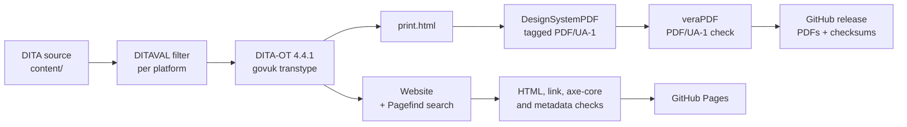

# Build and quality

Which tools build the outputs, and which checks must pass before anything is published.

Part of the [authoring plan](authoring-plan.md). Status: Draft 0.1, 15 October 2026. Decisions are tracked in the [decision log](decision-log.md).

Everything here is **planned**. WP1 builds it. Versions and behaviours were checked against the upstream projects on 15 October 2026. Check them again at the start of WP1.

## 1. Toolchain

| Tool | Version | Role | Notes |
|---|---|---|---|
| **DITA Open Toolkit** | 4.4.1 (latest, 21 August 2026) | Processes the DITA | The plugin needs 4.4.1 or later. |
| **Java** | 17 or later (21 LTS is fine) | Runs the toolkit and the PDF generator | |
| **iStandUK GOV.UK DITA plugin** `org.istanduk.gov-uk` | 1.3.0 (15 October 2026) | The `govuk` transtype: website, print document, page metadata, sitemap, `llms.txt` | Apache-2.0. It extends the toolkit's `html5` transtype. The registry entry we read listed versions up to 1.2.0, so install 1.3.0 from its release zip and verify the published SHA-256. |
| **DesignSystemPDF** | 0.1.2 (15 October 2026) | Renders the print document as a tagged PDF/UA-1 file | A separate product, not a DITA-OT plugin. Java only. Releases carry a SHA-256 and a build provenance attestation (`gh attestation verify`). Bundles Noto Sans (SIL OFL 1.1). Known limit: right-to-left scripts are not rendered. |
| **Pagefind** | 1.5.2 | Builds the site search index | Needed on the build machine only. Required in CI. Optional locally. |
| **veraPDF** | Pin in WP1 | Validates PDF/UA-1 | |
| **Nu HTML Checker** | Pin in WP1 | HTML validity | |
| **axe-core** with a headless browser | Pin in WP1 | WCAG 2.2 AA checks on built pages | The plugin repository ships a runner we can pin by tag. |
| **Link and metadata checkers** | Plugin repository tools at tag `v1.3.0` | Internal links, page metadata | Fetched in CI, pinned by tag and checksum. |
| **Vale**, spell checker | Pin in WP1 | Prose lint and British English spelling | |
| **Secret scanner** (such as gitleaks) | Pin in WP1 | Keeps secrets and private material out of a public repository | |

**Pinning policy**

- Every tool is pinned by exact version and SHA-256 in `build/tools.lock`. CI verifies the checksums.
- Upgrades arrive by pull request, with every gate run.
- Check upstream releases monthly. The plugin and the PDF generator are new and move quickly.
- The plugin and DesignSystemPDF meet through a numbered *print contract*. DesignSystemPDF 0.1.x understands contract 1, written by plugin 1.0.1 and later 1.x releases. Upgrade them together and check `designsystempdf --version`.

## 2. Local environment

- **Windows is the main authoring machine.**
- **Do not install the plugin into a system-wide toolkit under `C:\Program Files`.** Installing a plugin writes into the toolkit folder, which needs elevation, and the path contains spaces. Use a pinned copy in a short, user-writable folder such as `C:\dita-ot`. A very long toolkit path can also overrun the Windows launcher's command line limit.
- **Run `dita.bat`** from PowerShell or Command Prompt. The Unix `bin/dita` script run from Git Bash fails to load plugin Java libraries on Windows.
- **Scripts.** `build/scripts/bootstrap.ps1` downloads the pinned tools into `.tools/` and verifies their checksums. `build/scripts/build.ps1 -Platform <slug>` builds one publication. Bash equivalents serve CI, macOS and Linux. Both are thin wrappers over `dita --project`.
- **Container option.** A pinned builder image would make local and CI builds identical. WP1 evaluates it.
- **Editors.** Any XML editor with DTD validation works. Oxygen XML Editor has the fullest DITA support. Visual Studio Code with an XML extension works with an OASIS catalogue that maps the DITA public identifiers to the toolkit's DTDs. WP1 delivers the catalogue and the editor settings.
- **Preview.** Open `out/<slug>/index.html`. Search needs HTTP rather than a file path, so WP1 documents a one-line local static server.
- **Treat build messages as failures.** Any `GOVK*`, `DOTX*` or `DSPDF*` message fails the build in CI. Locally the script prints a summary.

## 3. Build parameters

Parameters live in a DITA-OT project file, one deliverable per publication. Each deliverable is a separate build and shares nothing with the others.

| Parameter | Planned value | Why |
|---|---|---|
| `--format` | `govuk` | The plugin's transtype. |
| `govuk.branding` | `neutral` | `official` (the GOV.UK crown) is for genuine GOV.UK services only. `nhs` is for NHS organisations only. `istanduk` is for iStandUK. Neutral carries no restricted identity. Our own identity comes from a publisher stylesheet (`args.css`) and `govuk.css.assets` (DEC-008). |
| `govuk.service.name` | The manual's title | Masthead and footer. |
| `govuk.phase`, `govuk.feedback.url` | `beta`, and the repository's issue form | A phase banner while the app is before 1.0. |
| `govuk.homepage.layout`, `govuk.homepage.depth` | `auto`, `2` | `grouped` for a bookmap with several chapters. |
| `govuk.search` | `yes` in CI, `auto` locally | Fails the build if Pagefind is missing. |
| `govuk.print` | `yes` | Needed for the PDF. |
| `govuk.pdf` | `yes` in CI, `auto` locally | Fails the build if the PDF generator is missing. |
| `govuk.pdf.paper`, `govuk.print.toc.depth` | `A4`, `3` | |
| `govuk.pdf.name` | `ufti-user-manual-<slug>` | The PDF's file name. |
| `govuk.print.max-topics` | Set above our topic count | The default is 500. Above it the print document and PDF are skipped with a warning. |
| `govuk.site.url` | The published address of each publication | Needed for `sitemap.xml`, `llms.txt`, canonical links and Open Graph URLs. |
| `govuk.sitemap`, `govuk.llms` | `auto` | On when the site URL is set. |
| `govuk.metadata` | `basic` | Open Graph, Dublin Core, canonical, previous, next and licence links. |
| `govuk.metadata.persons` | `no` | No person's name is published. |
| `govuk.organisation`, `govuk.organisation.url` | Set explicitly | Publisher metadata. |
| `govuk.licence.url` | The Apache-2.0 licence address | Written as `rel="license"`. |
| `govuk.og.image`, `govuk.favicon` | From WP6 | Share image and favicon. |
| `govuk.dates` | `no` | Until there is a reliable dating process (Q13). |
| `govuk.csp` | `meta` | GitHub Pages cannot set HTTP headers. |
| `govuk.footer.links` | Platform chooser, accessibility statement, source repository, licence | `label\|url` pairs separated by `;`. |
| `govuk.content.warnings` | `yes` | Reports scripts, remote images and embeds. The build never fails on content, so the gates read the warnings. |

The plugin warns about a misspelt `govuk.*` parameter (`GOVK009W`). The CI gate on warnings covers it.

## 4. Quality gates

All gates run on every pull request. A failure blocks the merge.

| Gate | Tool | Passes when |
|---|---|---|
| Valid DITA | DITA-OT validation against the DTDs | No `DOTJ` or `DOTX` errors |
| No build warnings | DITA-OT, plugin and PDF generator messages | Zero `GOVK*`, `DOTX*` and `DSPDF*` warnings |
| Valid HTML | Nu HTML Checker | Zero errors |
| Page structure | Script | Exactly one `h1` and one `main` per page |
| Web accessibility | axe-core with WCAG 2.2 AA rules | Zero violations |
| Links | Link checker | Zero broken internal links. External links reported for review. |
| Page metadata | Metadata checker | No missing required values (`GOVK012W`) |
| PDF/UA | veraPDF, PDF/UA-1 profile, on every PDF | Pass. PDF/UA-2 is advisory. |
| Alternative text | Source check and `DSPDF009W` | None missing |
| Prose and spelling | Vale and spell check | No errors |
| Structure lint | Project scripts ([authoring standards, section 13](authoring-standards.md#13-templates-and-linting)) | No violations |
| Key and image coverage | Project scripts ([platform strategy, section 10](platform-strategy.md#10-consistency-checks)) | Zero unresolved keys or images |
| Disclosure and secrets | Secret scanner and pattern check | No findings |
| Page weight and determinism | Plugin's checks | Within budget. The same input gives the same output. |

**Manual checks before each release**

- Screen reader pass on the real platform: NVDA and Narrator on Windows, TalkBack on Android, VoiceOver on iOS and macOS.
- Keyboard-only pass on the website.
- Zoom to 400% and reflow. Forced colours and high contrast.
- The PDF in Acrobat with the Tags and Reading Order panes, and in the PDF Accessibility Checker (PAC).
- Every new or changed task performed on each platform it covers.
- A novice usability session for each new chapter.

## 5. Continuous integration

Planned for GitHub Actions, in WP1.

| Job | Runs | Purpose |
|---|---|---|
| `lint` | Every push and pull request | Prose, structure, vocabulary, secrets. Fast. |
| `build` | A matrix: each platform manual, the good practice guide, the platform chooser | Install pinned tools from cache. Build site and PDF into `out/<slug>`. Upload as an artefact. |
| `check` | After `build`, per output | HTML, axe-core, links, metadata, veraPDF, determinism, page weight. |
| `coverage` | Once | Key and image coverage, applicability matrix. |
| `deploy` | `main` only | Assemble the root with the chooser, publish to GitHub Pages. |
| `release` | On a version tag | Attach PDFs, a zipped site, SHA-256 checksums and the applicability matrix to a GitHub release. |

Practices:

- Pin third-party actions to full commit SHAs. Keep Dependabot enabled for them.
- Default permissions are read-only. Only `deploy` gets Pages and OIDC write access.
- Cancel superseded runs on the same pull request.
- Run weekly against the pinned versions to catch upstream drift in the sources we fetch.
- The plugin's own repository and its consumer repositories are good examples of this shape.

## 6. Release, versioning and hosting

**Versioning**

- The manual's version follows the app's `MAJOR.MINOR.PATCH` and appears as `vrm` in the map metadata.
- Tag `vX.Y.Z` in this repository when the manual for app version X.Y.Z is released.
- Before 1.0 the manual is a beta, and the phase banner says so.
- `main` is always buildable and is published as "latest". Tagged releases are archived as PDFs and a zipped site. Whether earlier versions stay online is DEC-013.

**Release steps**

1. Confirm the app release candidate.
2. Refresh screenshots and compare the app with the inventory.
3. Update the "What is new" topic.
4. Run every gate and the manual checks.
5. Tag, publish and attach the artefacts.

**Hosting.** A GitHub Pages project site: `https://oughnic.github.io/uFTi-Docs/`, with the platform chooser at the root, each manual at `/<slug>/` and the guide at `/good-practice/` (DEC-014). Pages cannot set HTTP headers, so the site uses `govuk.csp=meta`. A custom domain can follow (Q4). The plugin's sites are static, with no cookies, no third-party requests and no analytics, so readers are not tracked. Feedback arrives through the repository's issues.

**Licences and notices.** Our own content is Apache-2.0. The generated site includes GOV.UK Frontend (MIT, Crown copyright) and the PDFs embed Noto fonts (SIL OFL 1.1). The colophon (WP10) lists these, and the plugin's notice files travel with the output.

## 7. Repository hygiene

- **Default branch** `main`, protected: pull requests required, CI green (DEC-016).
- **Branch names** `docs/<issue>-<slug>`. Commit messages follow `type(scope): subject`.
- **Labels:** `docs-impact`, `good-practice`, `needs-review-genealogy`, `a11y`, `platform-<slug>` and `wp-<n>`.
- **Secret scanning and push protection** switched on.
- **`SECURITY.md`** added in WP1, covering how to report a private-data leak or an accessibility barrier.
- **Images** are optimised PNGs. If history grows large, evaluate Git LFS, bearing in mind its bandwidth limits.
- **Never committed:** `out/`, `.tools/`, family-tree data files (`*.ged`, `*.gdz`, `*.gedzip`).
