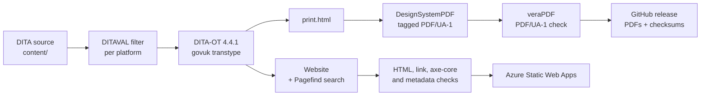

# Build and quality

Which tools build the outputs, and which checks must pass before anything is published.

Part of the [authoring plan](authoring-plan.md). Status: Draft 0.4, 16 October 2026. Decisions are tracked in the [decision log](decision-log.md).

WP1 built this: the scripts, the project files and the workflows are in [`build/`](../build/README.md) and `.github/workflows/`, and a throwaway fixture proves them. Versions were checked against the upstream projects on 17 October 2026 and are pinned in `build/tools.lock`; what WP1 settled is in the decision log (DEC-045 to DEC-053).



## 1. Toolchain

| Tool | Version | Role | Notes |
|---|---|---|---|
| **DITA Open Toolkit** | 4.4.1 (latest, 21 August 2026) | Processes the DITA | The plugin needs 4.4.1 or later. |
| **Java** | 17 or later (21 LTS is fine) | Runs the toolkit and the PDF generator | |
| **PowerShell** | 7 | Runs the build scripts and the theme checker | On every operating system. Preinstalled on GitHub-hosted runners. |
| **iStandUK GOV.UK DITA plugin** `org.istanduk.gov-uk` | 1.4.0 (24 October 2026) | The `govuk` transtype: website, print document, page metadata, sitemap, `llms.txt` | Apache-2.0. It extends the toolkit's `html5` transtype. The registry entry we read listed versions up to 1.2.0, so install 1.4.0 from its release zip, verify the published SHA-256 and check its build provenance with `gh attestation verify`. |
| **DesignSystemPDF** | 0.1.2 (15 October 2026) | Renders the print document as a tagged PDF/UA-1 file | A separate product, not a DITA-OT plugin. Java only. Releases carry a SHA-256 and a build provenance attestation (`gh attestation verify`). Bundles Noto Sans (SIL OFL 1.1). Known limit: right-to-left scripts are not rendered. |
| **Pagefind** | 1.5.2 | Builds the site search index | Needed on the build machine only. Required in CI. Optional locally. |
| **veraPDF** | 1.30.3 (greenfield) | Validates PDF/UA-1; PDF/UA-2 reported as advisory | The release is GPG-signed and carries no checksum file, so the lock pins the checksum the plugin project's own CI pins for the same build. Installed headless from its installer. |
| **Nu HTML Checker** | 26.10.12 | HTML validity | GitHub carries only a rolling `latest` release, so the pin is the `vnu-jar` npm package, published per version with the same `vnu.jar` and a registry integrity hash. |
| **axe-core** with a headless browser | axe-core 4.14.0 and Playwright 1.64.1, through the plugin repository's runner at tag `v1.4.0` | WCAG 2.2 AA checks on built pages | The runner's lock file fixes the versions; CI caches the browser by the hash of `tools.lock`. |
| **Link and metadata checkers** | Plugin repository tools at tag `v1.4.0` | Internal links, page metadata, page weight | Fetched file by file at the tag, each pinned by checksum; the metadata checker reads its tables from the installed plugin. Python; locally through Docker when Python is absent. |
| **Vale** with its readability rules, and a spell checker | Pin in WP1 | Prose lint, the reading-level targets (DEC-029) and British English spelling | The readability rules compute Flesch Reading Ease and Flesch-Kincaid grade per file. |
| **Secret scanner** gitleaks | 8.30.1 | Keeps secrets and private material out of a public repository | Scans the whole history on every pull request. GitHub's push protection is on as well. |

**Pinning policy**

- Every tool is pinned by exact version and SHA-256 in `build/tools.lock`. CI verifies the checksums.
- Upgrades arrive by pull request, with every gate run.
- Check upstream releases monthly. The plugin and the PDF generator are new and move quickly.
- The plugin and DesignSystemPDF meet through a numbered *print contract*. DesignSystemPDF 0.1.x understands contract 1, written by plugin 1.0.1 and later 1.x releases. Upgrade them together and check `designsystempdf --version`.

## 2. Local environment

- **Windows is the main authoring machine.**
- **Do not install the plugin into a system-wide toolkit under `C:\Program Files`.** Installing a plugin writes into the toolkit folder, which needs elevation, and the path contains spaces. Use a pinned copy in a short, user-writable folder such as `C:\dita-ot`. A very long toolkit path can also overrun the Windows launcher's command line limit.
- **Run `dita.bat`** from PowerShell or Command Prompt. The Unix `bin/dita` script run from Git Bash fails to load plugin Java libraries on Windows.
- **Scripts** ([build/README.md](../build/README.md)). `build/scripts/bootstrap.ps1` downloads the pinned tools and verifies their checksums: into `.tools/` at the repository root on Linux and macOS, and into `%LOCALAPPDATA%\ufti-tools` on Windows, because `dita.bat` repeats its own path once per library and a deep checkout (111 characters to the toolkit) overruns the command line (DEC-015; `UFTI_TOOLS` overrides). `build/scripts/build.ps1 -Project <name>` builds one project file, a thin wrapper over `dita --project` that fails on any warning. `bootstrap.sh` and `build.sh` are the bash twins for CI, macOS and Linux. The checks (`lint.ps1`, `check-source.ps1`, `check-output.ps1`) are PowerShell on every operating system, so each gate has one implementation.
- **Containers.** A builder image was evaluated and not adopted: the build is Java only and runs the same everywhere from the pinned tools, and an image would add a second thing to pin. The pinned `python` and `playwright` images in `tools.lock` serve one purpose, running the plugin repository's Python and Node checkers on a machine without Python or Node; CI installs those directly.
- **Editors.** Any XML editor with DTD validation works. Oxygen XML Editor has the fullest DITA support. Visual Studio Code with the Red Hat XML extension validates against the toolkit's DTDs through the toolkit's own OASIS catalogue, which `.vscode/settings.json` points at (`catalog-dita.xml` in the bootstrapped toolkit), and `.vscode/extensions.json` recommends the XML, Vale and PowerShell extensions.
- **Preview.** Open `out/<deliverable>/index.html`. Search needs HTTP rather than a file path: `jwebserver -d out/<deliverable> -p 8000` (Java's own static server, in every JDK from 18) serves it at `http://localhost:8000/`.
- **Treat build messages as failures.** Any `GOVK*`, `DOTX*` or `DSPDF*` message fails the build in CI. Locally the script prints a summary.

## 3. Build parameters

Parameters live in a DITA-OT project file, one deliverable per publication. Each deliverable is a separate build and shares nothing with the others.

| Parameter | Planned value | Why |
|---|---|---|
| `--format` | `govuk` | The plugin's transtype. |
| `govuk.branding` | `neutral` | `official` (the GOV.UK crown) is for genuine GOV.UK services only. `nhs` is for NHS organisations only. `istanduk` is for iStandUK. Neutral carries no restricted identity. Our own identity comes from the publisher stylesheet in [`build/theme/`](../build/theme/README.md) (DEC-008, DEC-024). |
| `govuk.service.name` | The manual's title | Masthead and footer. |
| `govuk.phase`, `govuk.feedback.url` | `beta`, and the repository's issue form | A phase banner while the app is before 1.0. |
| `govuk.homepage.layout`, `govuk.homepage.depth` | `auto`, `2` | `grouped` for a bookmap with several chapters. |
| `govuk.search` | `yes` | Fails the build if Pagefind is missing. Everywhere, not only in CI, because bootstrap installs it everywhere (DEC-047). |
| `govuk.print` | `yes` | Needed for the PDF. |
| `govuk.pdf` | `yes` | Fails the build if the PDF generator is missing. Everywhere, as for search (DEC-047). |
| `govuk.pdf.paper`, `govuk.print.toc.depth` | `A4`, `3` | |
| `govuk.pdf.name` | `ufti-user-manual-<platform>-<release>` and `ufti-quick-start-<platform>-<release>`, set by the build scripts from the release (DEC-141) | The PDF's file name, which says which version it is. |
| `govuk.print.max-topics` | Set above our topic count | The default is 500. Above it the print document and PDF are skipped with a warning. |
| `govuk.site.url` | `https://docs.ufti.com/<platform>/<release>/` for each manual, `.../start/` below it for the Quick Start, and the guide on the same host when it is built (DEC-146, DEC-141). Set by the build scripts from `build/publications.ini`, never in a project file for a published manual. | Needed for `sitemap.xml`, `llms.txt`, canonical links and Open Graph URLs. |
| `govuk.sitemap`, `govuk.llms` | `auto` | On when the site URL is set. |
| `govuk.metadata` | `basic` | Open Graph, Dublin Core, canonical, previous, next and licence links. |
| `govuk.metadata.persons` | `no` | No person's name is published. |
| `govuk.organisation`, `govuk.organisation.url` | Set explicitly | Publisher metadata. |
| `govuk.licence.url` | The Apache-2.0 licence address | Written as `rel="license"`. |
| `govuk.favicon`, `govuk.og.image` | `build/theme/assets/brand/ufti.ico`, and `theme/brand/ufti-share.png` (a path under the deliverable) | The favicon and the share image, from the brand artwork (`build/brand/README.md`, DEC-160 to DEC-163). The share image is copied beside the stylesheet with the rest of `govuk.css.assets`. | 
| `args.css`, `args.cssroot`, `args.copycss`, `args.csspath` | `ufti.css`, the path of `build/theme`, `yes`, `theme` | The publisher stylesheet. It is linked on every page and in the print document. In the project file the folder is given with `path="../theme"`, relative to the project file (confirmed in WP1). `args.csspath` keeps the stylesheet and its assets together under `theme/` in the output. |
| `govuk.css.assets`, `govuk.pdf.fonts` | `build/theme/assets`, `build/theme/assets/fonts` | The fonts the stylesheet names, hosted with the site (the policy `govuk.csp=meta` allows nothing else), and the same fonts for the PDF. Both given with `path`, as above. |
| `govuk.dates` | `no` | Until there is a reliable dating process (Q13). |
| `govuk.csp` | `meta` | The pages must work in the app's help frame and on any host, whether or not it can set headers. |
| `govuk.embed` | `yes` | The embedded view that the app's help panel frames (DEC-028). Ignored under official or NHS branding, which we never use. |
| `govuk.footer.links` | Platform chooser, the other versions of the platform and the Quick Start or the manual beside it (from the release, DEC-141), accessibility statement and privacy policy (pages of the root of the tree, addresses made from `base-url`, DEC-150), source repository, licence | `label\|url` pairs separated by `;`. The shared pairs are in `common.xml`; the build scripts put the release's pairs first. |
| `govuk.content.warnings` | `yes` | Reports scripts, remote images and embeds. The build never fails on content, so the gates read the warnings. |

The plugin warns about a misspelt `govuk.*` parameter (`GOVK009W`). The CI gate on warnings covers it.

## 4. Quality gates

All gates run on every pull request. A failure blocks the merge.

| Gate | Tool | Passes when |
|---|---|---|
| Valid DITA | DITA-OT validation against the DTDs | No `DOTJ` or `DOTX` errors |
| No build warnings | DITA-OT, plugin and PDF generator messages | Zero `GOVK*`, `DOTX*` and `DSPDF*` warnings |
| Valid HTML | Nu HTML Checker | Zero errors |
| Page structure | Script | Exactly one `h1` and one `main` per page |
| Web accessibility | axe-core with WCAG 2.2 AA rules | Zero violations |
| Links | Link checker | Zero broken internal links. External links reported for review. |
| Page metadata | Metadata checker | No missing required values (`GOVK012W`) |
| PDF/UA | veraPDF, PDF/UA-1 profile, on every PDF | Pass. PDF/UA-2 is advisory. |
| Alternative text | Source check and `DSPDF009W` | None missing |
| Prose and spelling | Vale and spell check | No errors |
| Structure lint | Project scripts ([authoring standards, section 13](authoring-standards.md#13-templates-and-linting)) | No violations |
| Key and image coverage | Project scripts ([platform strategy, section 10](platform-strategy.md#10-consistency-checks)) | Zero unresolved keys or images |
| Theme | `build/theme/check-theme.ps1` | Every colour pairing passes WCAG 2.2 AA, no colour sits outside the tokens, and the fonts and their licences are present |
| Disclosure and secrets | Secret scanner and pattern check | No findings |
| Reading level | Vale readability rules | Every topic within the targets (DEC-029), or every exception is a UI label, a proper name or a glossary term |
| Human-centred text | Lint | No GEDCOM tag or structure pattern (DEC-030), and no business-model words (DEC-040), in any topic |
| Diagram links | SVG link check | Every link inside an inlined SVG resolves |
| Help map coverage | Project script | Every screen in the inventory has a help target (DEC-028) |
| Plugin independence | Smoke build with the toolkit's stock `html5` transformation | The sources build without the plugin (DEC-042); its warnings are reported, not gated |
| Page weight and determinism | Plugin's checks | Within budget. The same input gives the same output. |

**Manual checks before each release**

- Screen reader pass on each real device: NVDA and Narrator on Windows, TalkBack on an Android phone and tablet, VoiceOver on an iPhone and iPad.
- Keyboard-only pass on the website.
- Zoom to 400% and reflow. Forced colours and high contrast.
- The PDF in Acrobat with the Tags and Reading Order panes, and in the PDF Accessibility Checker (PAC).
- Every new or changed task performed on each platform it covers.
- A novice usability session for each new chapter.

## 5. Continuous integration

Planned for GitHub Actions, in WP1.

| Job | Runs | Purpose |
|---|---|---|
| `lint` | Pushes to `dev`, `main`, `release/**` and `hotfix/**`, and every pull request | Prose, structure, vocabulary, secrets. Fast. |
| `build` | A matrix: the five manuals and their Quick Starts, the good practice guide, the device chooser and the ufti.com pages | Install pinned tools from cache. Build site and PDF into `out/<slug>`. Upload as an artefact. |
| `check` | After `build`, per output | HTML, axe-core, links, metadata, veraPDF, determinism, page weight. |
| `coverage` | Once | Key and image coverage, applicability matrix. |
| `site` | Pushes to `dev`, `main` and `release/**`, and pull requests that touch `build/` or `content/` (`.github/workflows/site.yml`) | Build the whole publishing tree with `build-site.sh`, check every link in it, keep the tree and the archives of the current releases as artefacts. Section 7. |
| `deploy` | `main` only, so only releases are published | Deploy the `site` artefact to Azure Static Web Apps. Not enabled: it needs a resource and a token that the maintainer creates (section 7). |
| `release` | On a version tag on `main` | Attach PDFs, a zipped site, SHA-256 checksums and the applicability matrix to a GitHub release. |

Practices:

- Pin third-party actions to full commit SHAs. Keep Dependabot enabled for them.
- Default permissions are read-only. Only `deploy` gets write access, and only to publish.
- Cancel superseded runs on the same pull request.
- Run weekly against the pinned versions to catch upstream drift in the sources we fetch.
- The plugin's own repository and its consumer repositories are good examples of this shape.

## 6. Release, versioning and hosting

**Versioning**

- The manual's version is the **uFTi app release** it was checked against (`Alpha-1`, `Beta-1`, `1.0`), declared once for each platform in `build/publications.ini` (DEC-141, section 7). The number the app itself prints is recorded there too (`app-version`) and with the pictures as `vrm` in the map metadata, and the build fails if they disagree. It is never taken from this repository's tags, the plugin or the toolkit.
- A tag on `main` marks the commit at which a release was published. It does not decide the release.
- Before 1.0 the manual is a beta, and the phase banner says so.
- `dev` is always buildable. Its builds are CI artefacts and are not published. `main` holds the latest release and is what is published. Each release is archived as a zip of its folder in the tree, and an earlier release stays online from its archive (DEC-143, section 7).

**Release steps**

1. Confirm the app release candidate, its release label and the version it prints.
2. Cut `release/X.Y.Z` from `dev`.
3. Refresh screenshots and compare the app with the inventory.
4. Update the "What is new" topic.
5. Keep the release being replaced: it must already be on the publish branch (section 7.6) before `release` and `app-version` change in `build/publications.ini`. Then change them, for the platforms that were checked against the new release.
6. Run every gate and the manual checks.
7. Merge `release/X.Y.Z` into `main` by pull request, then tag `vX.Y.Z`. The `release` and `deploy` jobs attach the artefacts and publish the site.
8. Merge `main` back into `dev`.

**Hosting.** The site lives at ufti.com (DEC-033): marketing pages at the root, each manual at `/docs/<platform>/<release>/` and the guide at `/good-practice/` ([site strategy](site-strategy.md)). The documentation tree is meant for Azure Static Web Apps (DEC-142, section 7); the pages keep `govuk.csp=meta`, so they work on any host and in the app's help frame. The plugin's sites are static, with no cookies, no third-party requests and no analytics (DEC-043), so readers are not tracked. Feedback arrives through the feedback link and the repository's issues.

**Licences and notices.** Our own content is Apache-2.0. The generated site includes GOV.UK Frontend (MIT, Crown copyright) and the PDFs embed Noto fonts (SIL OFL 1.1). The colophon (WP10) lists these, and the plugin's notice files travel with the output.

## 7. The publishing tree

One command builds everything that is published, in the shape of the site (DEC-140). The shape, the release rule and the hosting are decided in DEC-140 to DEC-143; this section is how they work.

### 7.1 The tree

```text
out/site/                                  the whole tree: this folder is what the host serves
  index.html                               the root: the platforms
  accessibility/index.html                 the accessibility statement (a page of the site, DEC-150)
  privacy/index.html                       the privacy policy (a page of the site, DEC-150)
  not-found.html                           the page for an address that is not there (status 404)
  staticwebapp.config.json                 Azure Static Web Apps: routes, headers, 404
  robots.txt  sitemap.xml  llms.txt  govuk/  theme/
  windows/
    index.html                             the platform's versions, newest first
    Alpha-1/                               the manual for uFTi Alpha-1 on Windows
      index.html  topics/  platforms/  glossary/  pagefind/  theme/ ...
      ufti-user-manual-windows-Alpha-1.pdf
      version.json                         platform, release, app version, PDF names
      start/                               the Quick Start for the same release
        index.html ...
        ufti-quick-start-windows-Alpha-1.pdf
  android-phone/  iphone/  ipad/  macos/   the same shape
```

`out/site/` is generated and, like the rest of `out/`, never committed (DEC-140). Each platform that has a manual has a section in `build/publications.ini`; the Android tablet has none until its manual exists.

### 7.2 The release is declared once

`build/publications.ini` is the one place a release is written. Each platform's section has its `release` (`Alpha-1`; later `Alpha-2`, `Beta-1`, `RC-1`, `1.0`, `1.2.3`), the `app-version` the app prints for that build, and the project files of the manual and the Quick Start. The build scripts read it and nothing else:

| Derived from the release | Value |
|---|---|
| Folder in the tree | `<platform>/<release>/`, and `start/` below it for the Quick Start |
| `govuk.site.url` | `<base-url><platform>/<release>/` (and `.../start/`), so canonical links, Open Graph addresses, `sitemap.xml` and `llms.txt` agree with the folder |
| `govuk.pdf.name` | `ufti-user-manual-<platform>-<release>` and `ufti-quick-start-<platform>-<release>` |
| `govuk.footer.links` | The chooser, the other versions of the platform, the Quick Start or the manual beside this one, and the accessibility statement and privacy policy at `<base-url>accessibility/` and `<base-url>privacy/` |

`build.ps1` and `build.sh` add these to the toolkit's command line for any project named in the file, so a project file for a published manual holds no address and no PDF name. The build fails, with a message that lists every problem, when:

- a platform has no `release`, or it is not `Alpha-N`, `Beta-N`, `RC-N` or a number such as `1.0` or `1.2.3`;
- the platform's pictures record an app version (`<vrm>` in `keys/images.ditamap`, `app.version` in `images/manifest.json`) that `app-version` does not state, or states differently (a release and its pictures change together);
- a project file, the base address or a folder name is wrong, or a platform appears twice.

The label is never read from this repository's tags, the plugin or the toolkit (DEC-141).

### 7.3 Building and checking the tree

```powershell
pwsh build/scripts/bootstrap.ps1                  # once
pwsh build/scripts/build-site.ps1 -Archive        # builds out/site and out/archive, then checks the tree
pwsh build/scripts/check-site.ps1                 # the check alone
```

`build/scripts/build-site.sh --archive` does the same on Linux and macOS. In order, it:

1. builds every manual and Quick Start with `build.ps1` (or `build.sh`): the toolkit and the plugin only, and any `GOVK*`, `DOTX*` or `DSPDF*` message stops it;
2. puts back the earlier releases it is given with `-Keep` (section 7.4);
3. writes the root and platform pages as DITA 1.3 into `out/generated/site-root/`, copies the hand-written pages of `content/site/` (the accessibility statement and the privacy policy) into it as `<name>/index.dita`, and builds them with `build/projects/site-root.xml`;
4. assembles `out/site/`, writes `version.json` beside each release and `staticwebapp.config.json` at the root;
5. with `-Archive`, writes one zip for each current release to `out/archive/`, and `SHA256SUMS`;
6. runs `check-site.ps1`.

`check-site.ps1` needs only PowerShell. It fails on a folder that should not be there, a release folder that is not a label in the agreed form or has no `version.json` that matches it, a missing website or PDF (a PDF must start `%PDF-`), a Static Web Apps configuration that is not valid or redirects to a page that is not there or does not send `latest` to the current release, and any link that does not resolve. It also fails when the accessibility statement or the privacy policy is missing, when a page footer does not link both at addresses that start with `base-url`, or when a page still links the accessibility statement on the marketing site. It follows every link in every page, including the root to a platform, a platform to its releases and PDFs, a manual to its Quick Start and back, and addresses that begin with the base address (the footer links, canonical links and the sitemaps) into the tree. It checks letter case exactly, because the host does, and that a link to a part of a page names an id the page has. It does not replace `check-output.ps1`, which runs on each deliverable and still must pass (`-Deliverable manual-windows`, and so on): it checks what only the whole tree can show. The root pages (`site-root`) are not run through `check-output.ps1` on their own: their links lead to the releases, which exist only in the assembled tree, so `check-site.ps1` is their link gate.

### 7.4 Keeping an earlier release

A static host replaces the whole site at each deploy, so an old release is online only if the new tree contains it (DEC-143). The archive is the unit:

1. `build-site -Archive` writes `out/archive/ufti-docs-<platform>-<release>.zip` for each current release, holding `<platform>/<release>/` and nothing else.
2. The store of earlier releases is the **publish branch** (section 7.6), which holds every release ever published. `build/scripts/kept-from-branch.sh <branch> <folder>` reads that branch and writes one such zip for each release it holds. `site.yml` runs it before every build. If the branch does not exist yet, nothing is kept.
3. A run with `-Keep <folder of zips>` puts each earlier release back in the tree, lists it on its platform page and gives it the longer cache time. The same release in the archive and in the build is replaced by the new build.
4. When a platform moves from `Alpha-1` to `Alpha-2`, change `release` in `build/publications.ini`. The publish branch still holds `Alpha-1`, so the build keeps it and publishes `Alpha-2` as the latest. (A maintainer can still keep the zips by hand, for example as assets of a pre-release, and pass the folder to `-Keep`; the branch is the way CI does it.) The build fails if a kept archive is newer than the current release, names a platform that is not in the file, or has no matching `version.json`.

### 7.5 Azure Static Web Apps

`staticwebapp.config.json` is written by the build because its routes depend on the releases. It holds: a redirect from `/<platform>/latest` (and `latest/start`, and anything below `latest/`) to the current release, each written once without its closing slash, because Azure treats a route with and without the slash as one route and refuses a file that has both (issue 79; `check-site` fails on a duplicate); a day's cache on every earlier release and five minutes for the rest; `x-content-type-options` and `referrer-policy` headers on every response; the content type of `.pdf`; and the 404 response, which serves `not-found.html`. (That page is served at the address that was asked for, so a relative link in it would be looked for below that address. The build therefore rewrites every relative link in `not-found.html`, the stylesheet, the scripts and the platform pages, to start with the path of `base-url` (`/govuk/…`), which is the same on every host and is allowed by the page's own Content-Security-Policy (issues 82 and 88).)

The workflow `.github/workflows/site.yml` builds the tree, checks it, keeps it as the artefact `site` and publishes it to the publish branch (section 7.6). It creates no Azure resource. Its `deploy` job (DEC-145) then uploads the tree to the Static Web App, after a successful publish, on a push to `main` or `release/**`, or on demand: `gh workflow run site.yml --ref dev -f publish=true -f deploy=true`. **To set it up:** create the Static Web App in Azure with the deployment source **Other** (do not let Azure link the repository: its own workflow would be overwritten at every publication), store its deployment token as the repository secret `AZURE_STATIC_WEB_APPS_API_TOKEN`, and give the GitHub environment `azure-production` the reviewers who must approve a deploy. To rotate the token, reset it in the portal and set the secret again. The job's `app_location` is the downloaded `site` artefact, with `skip_app_build: true`: nothing is built in Azure; the action is pinned to a full commit SHA. The first deploy should check the `latest` redirects, the 404 page, a PDF's content type, that a platform address without its closing slash works, and the tree's size against the plan's limit.

### 7.6 The publish branch

`out/` stays out of git on every ordinary branch, as it always has been. The finished tree is pushed to its own branch, `publish`, so that the output of this repository is a pushed asset (DEC-144).

- **What the branch holds.** `site/`, exactly the tree `build-site` assembled (`index.html`, `staticwebapp.config.json` and one folder for each platform with every release below it), and a short `README.md` that says what the branch is. No sources. An Azure Static Web App takes `site` as its app location, with no build step. The first publication had the tree at the root of the branch; the next one moves it, and `kept-from-branch.sh` reads either shape.
- **When it is written.** The `publish` job in `site.yml` runs after a successful build on a push to `main` or `release/**`, and on demand: run the workflow from any branch with **publish** ticked (`gh workflow run site.yml --ref dev -f publish=true`). A push to `dev` and a pull request build and check the tree but do not publish. A second input names another branch for a trial (`-f branch=publish-trial`).
- **How.** `build/scripts/publish-tree.sh out/site <branch>` replaces the branch by `site/` and the README in one new commit that names the source commit and the releases it holds. If the tree is the one already there, nothing is pushed. The job has `contents: write` and no other secret. Runs are queued, not cancelled, so two publications cannot overwrite each other.
- **Why every release is in the tree.** The branch is replaced, not added to. The earlier releases come back into the tree first, from the branch itself (`kept-from-branch.sh`, section 7.4), so a release that was published stays published. Never run `publish-tree.sh` on a tree built without them.
- **Never edit the branch by hand.** The next publication replaces it. To go back to an earlier publication, use the branch's history.
- **Size.** About 37 MB for five platforms and one release, and each new release adds its own folder. The history grows by about that much for each publication, which is why `dev` does not publish on every push.

## 8. Repository hygiene

- **Branches** (DEC-016). `dev` is the default and integration branch. `main` holds releases only. Both are protected, set up in WP1: pull requests required and CI green.
- **Work branches** are `docs/<issue>-<slug>` from `dev` (use `feat/` or `fix/` for tooling), merged by pull request into `dev`. Releases go through `release/X.Y.Z` into `main`. Urgent fixes use `hotfix/<slug>` from `main`, merged into `main` and back into `dev`. Commit messages follow `type(scope): subject`.
- **Labels:** `docs-impact`, `good-practice`, `needs-review-genealogy`, `a11y`, `platform-<slug>` and `wp-<n>`.
- **Secret scanning and push protection** switched on.
- **`SECURITY.md`** added in WP1, covering how to report a private-data leak or an accessibility barrier.
- **Images** are optimised PNGs. If history grows large, evaluate Git LFS, bearing in mind its bandwidth limits.
- **Never committed:** `out/`, `.tools/`, family-tree data files (`*.ged`, `*.gdz`, `*.gedzip`).
