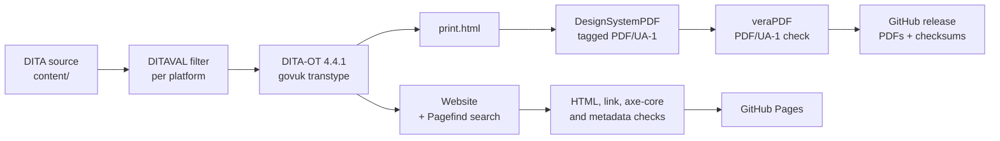

# Build and quality

Which tools build the outputs, and which checks must pass before anything is published.

Part of the [authoring plan](authoring-plan.md). Status: Draft 0.4, 16 October 2026. Decisions are tracked in the [decision log](decision-log.md).

WP1 built this: the scripts, the project files and the workflows are in [`build/`](../build/README.md) and `.github/workflows/`, and a throwaway fixture proves them. Versions were checked against the upstream projects on 17 October 2026 and are pinned in `build/tools.lock`; what WP1 settled is in the decision log (DEC-045 to DEC-053).

## 1. Toolchain

| Tool | Version | Role | Notes |
|---|---|---|---|
| **DITA Open Toolkit** | 4.4.1 (latest, 21 August 2026) | Processes the DITA | The plugin needs 4.4.1 or later. |
| **Java** | 17 or later (21 LTS is fine) | Runs the toolkit and the PDF generator | |
| **PowerShell** | 7 | Runs the build scripts and the theme checker | On every operating system. Preinstalled on GitHub-hosted runners. |
| **iStandUK GOV.UK DITA plugin** `org.istanduk.gov-uk` | 1.4.0 (24 October 2026) | The `govuk` transtype: website, print document, page metadata, sitemap, `llms.txt` | Apache-2.0. It extends the toolkit's `html5` transtype. The registry entry we read listed versions up to 1.2.0, so install 1.4.0 from its release zip, verify the published SHA-256 and check its build provenance with `gh attestation verify`. |
| **DesignSystemPDF** | 0.1.2 (15 October 2026) | Renders the print document as a tagged PDF/UA-1 file | A separate product, not a DITA-OT plugin. Java only. Releases carry a SHA-256 and a build provenance attestation (`gh attestation verify`). Bundles Noto Sans (SIL OFL 1.1). Known limit: right-to-left scripts are not rendered. |
| **Pagefind** | 1.5.2 | Builds the site search index | Needed on the build machine only. Required in CI. Optional locally. |
| **veraPDF** | 1.30.3 (greenfield) | Validates PDF/UA-1; PDF/UA-2 reported as advisory | The release is GPG-signed and carries no checksum file, so the lock pins the checksum the plugin project's own CI pins for the same build. Installed headless from its installer. |
| **Nu HTML Checker** | 26.10.12 | HTML validity | GitHub carries only a rolling `latest` release, so the pin is the `vnu-jar` npm package, published per version with the same `vnu.jar` and a registry integrity hash. |
| **axe-core** with a headless browser | axe-core 4.14.0 and Playwright 1.64.1, through the plugin repository's runner at tag `v1.4.0` | WCAG 2.2 AA checks on built pages | The runner's lock file fixes the versions; CI caches the browser by the hash of `tools.lock`. |
| **Link and metadata checkers** | Plugin repository tools at tag `v1.4.0` | Internal links, page metadata, page weight | Fetched file by file at the tag, each pinned by checksum; the metadata checker reads its tables from the installed plugin. Python; locally through Docker when Python is absent. |
| **Vale** with its readability rules, and a spell checker | Pin in WP1 | Prose lint, the reading-level targets (DEC-029) and British English spelling | The readability rules compute Flesch Reading Ease and Flesch-Kincaid grade per file. |
| **Secret scanner** gitleaks | 8.30.1 | Keeps secrets and private material out of a public repository | Scans the whole history on every pull request. GitHub's push protection is on as well. |

**Pinning policy**

- Every tool is pinned by exact version and SHA-256 in `build/tools.lock`. CI verifies the checksums.
- Upgrades arrive by pull request, with every gate run.
- Check upstream releases monthly. The plugin and the PDF generator are new and move quickly.
- The plugin and DesignSystemPDF meet through a numbered *print contract*. DesignSystemPDF 0.1.x understands contract 1, written by plugin 1.0.1 and later 1.x releases. Upgrade them together and check `designsystempdf --version`.

## 2. Local environment

- **Windows is the main authoring machine.**
- **Do not install the plugin into a system-wide toolkit under `C:\Program Files`.** Installing a plugin writes into the toolkit folder, which needs elevation, and the path contains spaces. Use a pinned copy in a short, user-writable folder such as `C:\dita-ot`. A very long toolkit path can also overrun the Windows launcher's command line limit.
- **Run `dita.bat`** from PowerShell or Command Prompt. The Unix `bin/dita` script run from Git Bash fails to load plugin Java libraries on Windows.
- **Scripts** ([build/README.md](../build/README.md)). `build/scripts/bootstrap.ps1` downloads the pinned tools and verifies their checksums: into `.tools/` at the repository root on Linux and macOS, and into `%LOCALAPPDATA%\ufti-tools` on Windows, because `dita.bat` repeats its own path once per library and a deep checkout (111 characters to the toolkit) overruns the command line (DEC-015; `UFTI_TOOLS` overrides). `build/scripts/build.ps1 -Project <name>` builds one project file, a thin wrapper over `dita --project` that fails on any warning. `bootstrap.sh` and `build.sh` are the bash twins for CI, macOS and Linux. The checks (`lint.ps1`, `check-source.ps1`, `check-output.ps1`) are PowerShell on every operating system, so each gate has one implementation.
- **Containers.** A builder image was evaluated and not adopted: the build is Java only and runs the same everywhere from the pinned tools, and an image would add a second thing to pin. The pinned `python` and `playwright` images in `tools.lock` serve one purpose, running the plugin repository's Python and Node checkers on a machine without Python or Node; CI installs those directly.
- **Editors.** Any XML editor with DTD validation works. Oxygen XML Editor has the fullest DITA support. Visual Studio Code with the Red Hat XML extension validates against the toolkit's DTDs through the toolkit's own OASIS catalogue, which `.vscode/settings.json` points at (`catalog-dita.xml` in the bootstrapped toolkit), and `.vscode/extensions.json` recommends the XML, Vale and PowerShell extensions.
- **Preview.** Open `out/<deliverable>/index.html`. Search needs HTTP rather than a file path: `jwebserver -d out/<deliverable> -p 8000` (Java's own static server, in every JDK from 18) serves it at `http://localhost:8000/`.
- **Treat build messages as failures.** Any `GOVK*`, `DOTX*` or `DSPDF*` message fails the build in CI. Locally the script prints a summary.

## 3. Build parameters

Parameters live in a DITA-OT project file, one deliverable per publication. Each deliverable is a separate build and shares nothing with the others.

| Parameter | Planned value | Why |
|---|---|---|
| `--format` | `govuk` | The plugin's transtype. |
| `govuk.branding` | `neutral` | `official` (the GOV.UK crown) is for genuine GOV.UK services only. `nhs` is for NHS organisations only. `istanduk` is for iStandUK. Neutral carries no restricted identity. Our own identity comes from the publisher stylesheet in [`build/theme/`](../build/theme/README.md) (DEC-008, DEC-024). |
| `govuk.service.name` | The manual's title | Masthead and footer. |
| `govuk.phase`, `govuk.feedback.url` | `beta`, and the repository's issue form | A phase banner while the app is before 1.0. |
| `govuk.homepage.layout`, `govuk.homepage.depth` | `auto`, `2` | `grouped` for a bookmap with several chapters. |
| `govuk.search` | `yes` | Fails the build if Pagefind is missing. Everywhere, not only in CI, because bootstrap installs it everywhere (DEC-047). |
| `govuk.print` | `yes` | Needed for the PDF. |
| `govuk.pdf` | `yes` | Fails the build if the PDF generator is missing. Everywhere, as for search (DEC-047). |
| `govuk.pdf.paper`, `govuk.print.toc.depth` | `A4`, `3` | |
| `govuk.pdf.name` | `ufti-user-manual-<slug>` | The PDF's file name. |
| `govuk.print.max-topics` | Set above our topic count | The default is 500. Above it the print document and PDF are skipped with a warning. |
| `govuk.site.url` | `https://ufti.com/docs/<device>/` for each manual and `https://ufti.com/good-practice/` for the guide (DEC-033) | Needed for `sitemap.xml`, `llms.txt`, canonical links and Open Graph URLs. |
| `govuk.sitemap`, `govuk.llms` | `auto` | On when the site URL is set. |
| `govuk.metadata` | `basic` | Open Graph, Dublin Core, canonical, previous, next and licence links. |
| `govuk.metadata.persons` | `no` | No person's name is published. |
| `govuk.organisation`, `govuk.organisation.url` | Set explicitly | Publisher metadata. |
| `govuk.licence.url` | The Apache-2.0 licence address | Written as `rel="license"`. |
| `govuk.og.image`, `govuk.favicon` | From WP6 | Share image and favicon. |
| `args.css`, `args.cssroot`, `args.copycss`, `args.csspath` | `ufti.css`, the path of `build/theme`, `yes`, `theme` | The publisher stylesheet. It is linked on every page and in the print document. In the project file the folder is given with `path="../theme"`, relative to the project file (confirmed in WP1). `args.csspath` keeps the stylesheet and its assets together under `theme/` in the output. |
| `govuk.css.assets`, `govuk.pdf.fonts` | `build/theme/assets`, `build/theme/assets/fonts` | The fonts the stylesheet names, hosted with the site (the policy `govuk.csp=meta` allows nothing else), and the same fonts for the PDF. Both given with `path`, as above. |
| `govuk.dates` | `no` | Until there is a reliable dating process (Q13). |
| `govuk.csp` | `meta` | GitHub Pages cannot set HTTP headers. |
| `govuk.embed` | `yes` | The embedded view that the app's help panel frames (DEC-028). Ignored under official or NHS branding, which we never use. |
| `govuk.footer.links` | Platform chooser, accessibility statement, source repository, licence | `label\|url` pairs separated by `;`. |
| `govuk.content.warnings` | `yes` | Reports scripts, remote images and embeds. The build never fails on content, so the gates read the warnings. |

The plugin warns about a misspelt `govuk.*` parameter (`GOVK009W`). The CI gate on warnings covers it.

## 4. Quality gates

All gates run on every pull request. A failure blocks the merge.

| Gate | Tool | Passes when |
|---|---|---|
| Valid DITA | DITA-OT validation against the DTDs | No `DOTJ` or `DOTX` errors |
| No build warnings | DITA-OT, plugin and PDF generator messages | Zero `GOVK*`, `DOTX*` and `DSPDF*` warnings |
| Valid HTML | Nu HTML Checker | Zero errors |
| Page structure | Script | Exactly one `h1` and one `main` per page |
| Web accessibility | axe-core with WCAG 2.2 AA rules | Zero violations |
| Links | Link checker | Zero broken internal links. External links reported for review. |
| Page metadata | Metadata checker | No missing required values (`GOVK012W`) |
| PDF/UA | veraPDF, PDF/UA-1 profile, on every PDF | Pass. PDF/UA-2 is advisory. |
| Alternative text | Source check and `DSPDF009W` | None missing |
| Prose and spelling | Vale and spell check | No errors |
| Structure lint | Project scripts ([authoring standards, section 13](authoring-standards.md#13-templates-and-linting)) | No violations |
| Key and image coverage | Project scripts ([platform strategy, section 10](platform-strategy.md#10-consistency-checks)) | Zero unresolved keys or images |
| Theme | `build/theme/check-theme.ps1` | Every colour pairing passes WCAG 2.2 AA, no colour sits outside the tokens, and the fonts and their licences are present |
| Disclosure and secrets | Secret scanner and pattern check | No findings |
| Reading level | Vale readability rules | Every topic within the targets (DEC-029), or every exception is a UI label, a proper name or a glossary term |
| Human-centred text | Lint | No GEDCOM tag or structure pattern (DEC-030), and no business-model words (DEC-040), in any topic |
| Diagram links | SVG link check | Every link inside an inlined SVG resolves |
| Help map coverage | Project script | Every screen in the inventory has a help target (DEC-028) |
| Plugin independence | Smoke build with the toolkit's stock `html5` transformation | The sources build without the plugin (DEC-042); its warnings are reported, not gated |
| Page weight and determinism | Plugin's checks | Within budget. The same input gives the same output. |

**Manual checks before each release**

- Screen reader pass on each real device: NVDA and Narrator on Windows, TalkBack on an Android phone and tablet, VoiceOver on an iPhone and iPad.
- Keyboard-only pass on the website.
- Zoom to 400% and reflow. Forced colours and high contrast.
- The PDF in Acrobat with the Tags and Reading Order panes, and in the PDF Accessibility Checker (PAC).
- Every new or changed task performed on each platform it covers.
- A novice usability session for each new chapter.

## 5. Continuous integration

Planned for GitHub Actions, in WP1.

| Job | Runs | Purpose |
|---|---|---|
| `lint` | Pushes to `dev`, `main`, `release/**` and `hotfix/**`, and every pull request | Prose, structure, vocabulary, secrets. Fast. |
| `build` | A matrix: the five manuals and their Quick Starts, the good practice guide, the device chooser and the ufti.com pages | Install pinned tools from cache. Build site and PDF into `out/<slug>`. Upload as an artefact. |
| `check` | After `build`, per output | HTML, axe-core, links, metadata, veraPDF, determinism, page weight. |
| `coverage` | Once | Key and image coverage, applicability matrix. |
| `deploy` | `main` only, so only releases are published | Assemble the root with the chooser, publish to GitHub Pages. |
| `release` | On a version tag on `main` | Attach PDFs, a zipped site, SHA-256 checksums and the applicability matrix to a GitHub release. |

Practices:

- Pin third-party actions to full commit SHAs. Keep Dependabot enabled for them.
- Default permissions are read-only. Only `deploy` gets Pages and OIDC write access.
- Cancel superseded runs on the same pull request.
- Run weekly against the pinned versions to catch upstream drift in the sources we fetch.
- The plugin's own repository and its consumer repositories are good examples of this shape.

## 6. Release, versioning and hosting

**Versioning**

- The manual's version follows the app's `MAJOR.MINOR.PATCH` and appears as `vrm` in the map metadata.
- Tag `vX.Y.Z` on `main` when the manual for app version X.Y.Z is released.
- Before 1.0 the manual is a beta, and the phase banner says so.
- `dev` is always buildable. Its builds are CI artefacts and are not published. `main` holds the latest release and is what GitHub Pages publishes. Tagged releases are archived as PDFs and a zipped site. Whether earlier versions stay online is DEC-013.

**Release steps**

1. Confirm the app release candidate.
2. Cut `release/X.Y.Z` from `dev`.
3. Refresh screenshots and compare the app with the inventory.
4. Update the "What is new" topic.
5. Run every gate and the manual checks.
6. Merge `release/X.Y.Z` into `main` by pull request, then tag `vX.Y.Z`. The `release` and `deploy` jobs attach the artefacts and publish the site.
7. Merge `main` back into `dev`.

**Hosting.** The site lives at ufti.com (DEC-033): marketing pages at the root, each manual at `/docs/<device>/` and the guide at `/good-practice/` ([site strategy](site-strategy.md)). GitHub Pages serves the custom domain until headers, redirects or logs are needed (Q26). Pages cannot set HTTP headers, so the site uses `govuk.csp=meta`. The plugin's sites are static, with no cookies, no third-party requests and no analytics (DEC-043), so readers are not tracked. Feedback arrives through the feedback link and the repository's issues.

**Licences and notices.** Our own content is Apache-2.0. The generated site includes GOV.UK Frontend (MIT, Crown copyright) and the PDFs embed Noto fonts (SIL OFL 1.1). The colophon (WP10) lists these, and the plugin's notice files travel with the output.

## 7. Repository hygiene

- **Branches** (DEC-016). `dev` is the default and integration branch. `main` holds releases only. Both are protected, set up in WP1: pull requests required and CI green.
- **Work branches** are `docs/<issue>-<slug>` from `dev` (use `feat/` or `fix/` for tooling), merged by pull request into `dev`. Releases go through `release/X.Y.Z` into `main`. Urgent fixes use `hotfix/<slug>` from `main`, merged into `main` and back into `dev`. Commit messages follow `type(scope): subject`.
- **Labels:** `docs-impact`, `good-practice`, `needs-review-genealogy`, `a11y`, `platform-<slug>` and `wp-<n>`.
- **Secret scanning and push protection** switched on.
- **`SECURITY.md`** added in WP1, covering how to report a private-data leak or an accessibility barrier.
- **Images** are optimised PNGs. If history grows large, evaluate Git LFS, bearing in mind its bandwidth limits.
- **Never committed:** `out/`, `.tools/`, family-tree data files (`*.ged`, `*.gdz`, `*.gedzip`).
