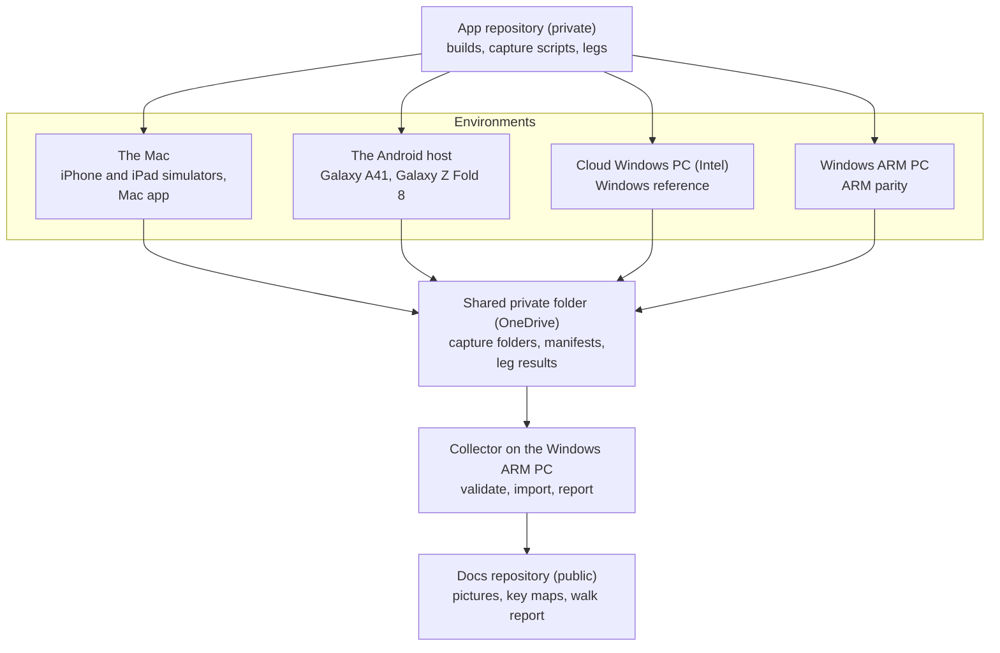
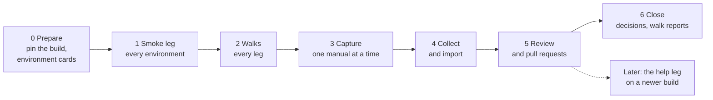

# The walk plan

How the machines and devices work together to walk the documented apps, record what a reader will see and capture fresh pictures, on the closed Alpha-1 build. Part of the [authoring plan](../authoring-plan.md). Written 6 November 2026 for [issue 129](https://github.com/oughnic/uFTi-Docs/issues/129). Decision: DEC-209. The first sheet it uses is [the dates, places and names walk](dates-places-names.md).

This plan is public. It names no machine, no account, no serial number, no build number beyond the released Alpha-1, and nothing from the application repository. Devices are named by model only.

## 1. What the walks are for

1. **Settle what the pages say.** Some statements in the pages were written from the app team's reading of the code. A walk shows them on a screen.
2. **Fresh pictures for Alpha-1.** Capture every documented device again, on the one closed build, so that every picture and every page describe the same app.

The application repository also walks targets that are not documented. They are tracked there (section 7), and this plan says nothing more about them.

## 2. Rules it keeps

- **Capture scripts stay in the application repository** (DEC-022). This repository holds the catalogue, the importer, the pictures, the manifests and the walk reports.
- **Pictures come from a release build, with the Brontë dataset only,** in the Oxford and slate theme, light, in en-GB, from a throwaway data folder (DEC-023 to DEC-025).
- **The importer refuses a picture from a different build.** Every leg runs the same build.
- **No serial number enters this repository.** The importer refuses a manifest that has one.
- **Raw captures never go into Git.** Only pictures that the importer accepts and a person has reviewed are committed.

## 3. What is walked, and where

### 3.1 The environments

| Role | Operating system | What runs there |
|---|---|---|
| **The Mac** | macOS | The iPhone and iPad simulators, and the Mac app |
| **The Android host** | Windows | The Galaxy A41 (SM-A415F) and the Galaxy Z Fold 8, over adb |
| **The cloud Windows PC** | Windows, Intel | The Windows reference |
| **The Windows ARM PC** | Windows, Arm | The collector, and a parity walk of the ARM build |

WSL2 is available on all three Windows machines. It is a Linux twin of CI, so that `build.sh`, `output-hash.sh` and `check-output.ps1` can be run there as CI runs them.

### 3.2 The legs

A **leg** is one target on one environment.

| Leg | Target and device | Environment | Gives |
|---|---|---|---|
| `windows-x64` | Windows (WinUI), clean profile, 1280 by 800 at 200% | Cloud Windows PC | The **reference**: walk and pictures |
| `windows-arm64` | Windows (WinUI) on Arm | Windows ARM PC | A parity walk: does it behave the same? No pictures |
| `android-phone` | Galaxy A41, Android 12, 1080 by 2400 | Android host | Walk and pictures (DEC-088) |
| `android-fold` | Galaxy Z Fold 8 | Android host | A **behaviour walk only**: the tablet statements that are not confirmed (section 8). No pictures |
| `android-tablet` | Pixel Tablet emulator profile, Android 16, 2560 by 1600 | To be settled (section 10) | Pictures (DEC-181) |
| `iphone` | iPhone 17 Pro simulator, iOS 26.5 | Mac | Walk and pictures (DEC-184) |
| `ipad` | iPad Air 11-inch (M4) simulator, iOS 26.5 | Mac | Walk and pictures (DEC-187) |
| `mac` | The Mac manual's reference target | Mac | Walk and pictures, once the target is settled (section 10) |

The Android phone and the Fold share one host, and the two simulators share the Mac. Devices with different serial numbers can be driven at the same time. The Mac app uses the real screen, so it runs on its own, with nothing else using the mouse.

## 4. How the environments work together



The sections that follow describe the boxes, in order.

### 4.1 A run, a build and its legs

A **run** has an id, such as `alpha-1-walk-1`, and one build: the closed Alpha-1, shown in the app as 0.1.0 (1). A run is a set of legs.

The list of legs belongs in the application repository, because it names the capture scripts and the device profiles, and it covers targets that are not documented. This repository keeps what it needs from each leg: the catalogue of keys for each manual, the importer, and the walk reports.

### 4.2 What a leg does

1. **Preflight.** Install the pinned build. Set the Oxford and slate theme, light, and en-GB. Start from a throwaway data folder. Check that the app shows the run's build. Write an **environment card**: operating system, version, screen size, scale. Add no serial number and no host name.
2. **Walk.** Do the sheet for the leg. Mark each row Same, Different or Not found.
3. **Capture.** Run the scripted replay from the application repository. If it is not ready, capture by hand as the [screenshot strategy](../screenshot-strategy.md#45-manual-capture-fallback) says.
4. **Drop.** Copy the result to the shared folder and stop. Nothing else in the leg depends on another machine.

The wrapper that does steps 1 and 4 the same way on every environment lives in the application repository, with the capture scripts it calls.

### 4.3 The shared folder

A private folder in OneDrive, synced to every machine. It holds one folder per leg, and nothing in it is committed to Git.

```
<run>/
  run.json                    the run id, the build, the legs and who owns each
  <leg>/
    leg-result.json           status, deviations, the environment card
    manifest.json             as the screenshot strategy describes, with no serial number
    <name>.png                one file per key
    notes.md                  the sheet, filled in, and anything else seen
    SHA256SUMS
```

### 4.4 The collector

`build/walks/collect-walk.ps1 <run>` runs on the Windows ARM PC, because the importer's crop and resize run on Windows. It checks that every leg is present and for the same build, that the hashes match, that no manifest carries a serial number, and that every focus person is allowed. Then it runs the importer for each documented manual, merges the filled-in sheets into one table with a column for each leg, and lists for each changed picture the topics to recheck.

### 4.5 Review, then Git

Nothing is committed until a person has looked at it.

- **Pictures.** One pull request for each manual. The report's list of topics is the reviewer's checklist.
- **Words.** One small pull request for each kind of correction to the pages, and one for the walk report.

### 4.6 Where Claude sessions fit

State lives in the shared folder and on issue 129, not in a conversation. A session on each machine can run its legs and report in the same files, and one session can coordinate. Each leg ticks its line on issue 129 when it is dropped. The plan works with only people and scripts.

## 5. Order



1. **Prepare.** Install the closed Alpha-1 build on every environment. Write the environment cards.
2. **Smoke leg.** Start the app, open a tree, check the version and the theme, and drop the result. Every environment, at the same time.
3. **Walks.** Every leg, at the same time. Do the cloud Windows PC, the Galaxy A41 and the Mac first, because they settle the most open statements.
4. **Capture.** One manual at a time on a machine. Different manuals can run on different machines.
5. **Collect, review, close.** When the pictures and the sheet are in, DEC-193 and DEC-203 can move to Accepted.

## 6. The build: the closed Alpha-1

Every leg runs the closed Alpha-1 build. `build/publications.ini` does not change, and no new release is declared. The pictures replace the earlier ones for Alpha-1.

Some pages were written from the app team's answers about a build that is newer than Alpha-1. A row that differs on Alpha-1 is marked Different, with the build, and then a person decides whether the page or the release should move.

### 6.1 Help on help

The help links need a newer build than Alpha-1. The app cannot open `places.place` or `people.name` from a field until it has them, and the proposed help maps are meant for development builds of the app. So these rows cannot be walked on Alpha-1:

- Row 1.15 of the dates, places and names sheet (a help control on the date editor), row 3.4 (on a place field) and row 4.6 (on a name field).
- Whether the Help button on each screen opens the page that the help map names.

They move to a **help leg**, run later on a development build that reads the published help maps. It is a coordination item with the app team, and it belongs to the work in [issue 16](https://github.com/oughnic/uFTi-Docs/issues/16) and to the later Alpha-2 plan. The help leg needs three things before it can run: a build with the help links, the proposed help maps built into that build, and the pages live on the host.

## 7. Targets that are not documented

The application repository walks other targets that we do not document and do not plan to release. It tracks them, and anything it learns from them, in its own issues and plans. This repository holds no detail about them, and no manual, picture or page describes them.

A leg for such a target may use the same environments and the same shared folder. Nothing from it reaches the importer, the pictures or the pages.

## 8. Rows that the walk is meant to settle

| Source | What it settles | Legs |
|---|---|---|
| [Dates, places and names sheet](dates-places-names.md) | The date editor, the place box, the name prompt, and the second line under a source | `windows-x64`, `windows-arm64`, `android-phone`, `iphone`, `ipad`, `mac` |
| The unconfirmed mobile differences ([issue 115](https://github.com/oughnic/uFTi-Docs/issues/115)) | Whether the form opens part of the way down, the file card delay, the full-screen sheet and its count, the sources count on tablets, and two file cards to a row | `android-phone`, `android-fold`, `iphone`, `ipad` |
| The camera route and the photos buttons ([issue 68](https://github.com/oughnic/uFTi-Docs/issues/68)) | The camera route on a device | `android-phone`, `android-fold` |
| The walk reports for Alpha-1 | Any picture or page that is out of date | Every leg |

## 9. Care on every leg

- **Clean profiles.** A generic user name, a throwaway data folder, no personal paths, no notifications and no other app in a picture.
- **The physical phones.** Capture inside the app, which leaves out the status bar and notifications. Check a picture of a system screen for personal information before it enters the shared folder.
- **The Fold.** Note which screen the app is on, the cover or the inner one, and the fold state, in the environment card.
- **Screens that depend on today's date or on random order** are flagged in the catalogue. A leg notes them and does not re-capture them for no reason.
- **No secrets in the shared folder.** It holds pictures, manifests and notes only.

## 10. Open points

| Point | Who decides |
|---|---|
| **The Mac manual's reference target.** [DEC-125](../decision-log.md) names AppKit and has not chosen a reference machine. The supported desktop target on a Mac in MAUI is Mac Catalyst, so the token `MacAppKit` and the reference may need another look. | Maintainer |
| **Where the Pixel Tablet emulator runs.** It needs an Intel machine with hardware virtualisation. | Maintainer |
| **The help leg:** the build, the date, and the published maps. | App team, with the maintainer |
| **Where the list of legs and the wrapper live.** The application repository is proposed (section 4.1). | Maintainer |
| **Sessions on the other machines.** Whether to run Claude sessions there, or to drive the legs by hand. | Maintainer |

## 11. What gets built, in order

1. The #129 sheet widened to a column for each leg.
2. In the application repository: the list of legs, the wrapper and the environment card.
3. In this repository: `build/walks/collect-walk.ps1`.
4. The first run: the smoke leg on every environment.
